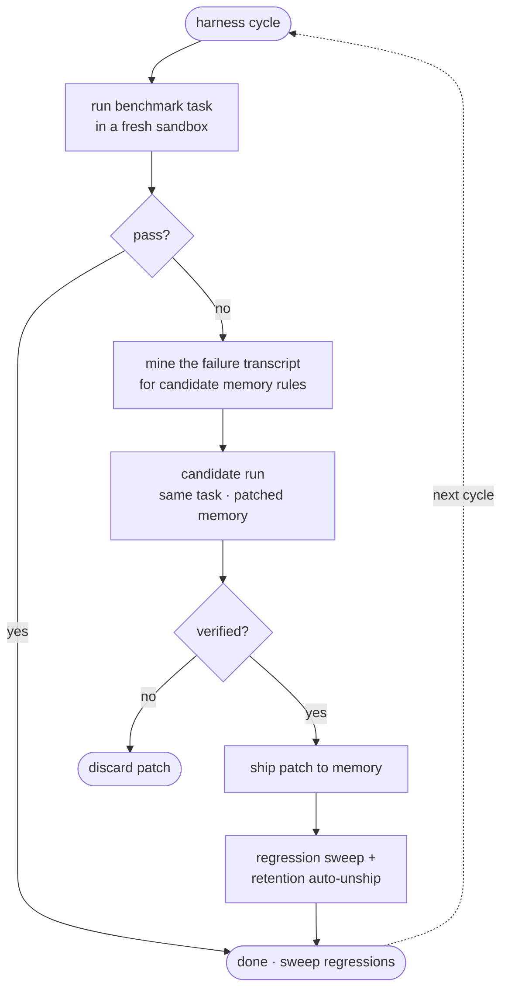

<p align="center">
  
</p>

# unown

Unown takes the open-source **[pi coding agent](https://github.com/badlogic/pi-mono)** and turns it into a full-fledged **self-learning agent**, applying the five mechanisms Anthropic popularized by *using Claude Code to improve Claude Code*:

> Let the agent find its own weaknesses. Let it fix them. Let it remember what worked.

Use it two ways:

- **In your terminal** — `unown` gives you a full interactive coding-agent session (the real pi TUI) in your actual project directory, with tiered memory injected, guardrail hooks active, and session notes captured for learning.
- **As a learning backend** — the engine keeps running harness cycles, AutoDream consolidation and background jobs; your terminal sessions feed it notes, and it writes improved memory back into your project.

<p align="center">
  <a href="https://bun.sh"></a>
  <a href="https://www.typescriptlang.org"></a>
  <a href="https://nextjs.org"></a>
  <a href="https://react.dev"></a>
  <a href="https://tailwindcss.com"></a>
  <a href="https://www.prisma.io"></a>
  <a href="https://github.com/containers/bubblewrap"></a>
  <a href="LICENSE"></a>
</p>

**[Dashboard tour](#mission-control)** · **[Architecture](#architecture)** · **[The learning loop](#the-learning-loop)** · **[Quickstart](#quickstart)** · **[Configuration](#configuration)** · **[Security](#security-model)** · **[What it learned](#what-a-learning-session-looks-like)**


## The five mechanisms

| # | Mechanism | Where it lives | What it does |
|---|-----------|----------------|--------------|
| 1 | **Tiered Memory** | [`memory.ts`](pi-repo/packages/self-learning/src/memory.ts) · [`term.ts`](pi-repo/packages/self-learning/src/term.ts) | Four tiers — policy → project → user → local — merged most-specific-wins and injected into every agent session (engine sandboxes *and* terminal sessions). Every write is versioned, attributable (`seed` / `harness` / `autodream` / `manual` / `rollback`) and rollback-able. |
| 2 | **Self-Improving Harness** | [`harness.ts`](pi-repo/packages/self-learning/src/harness.ts) | Runs a benchmark task → if it fails, mines the failure transcript → asks the LLM for memory rules that would have prevented it → re-runs a *candidate* with the patched memory → ships the patch only if verification passes (then sweeps for regressions). Shipped patches that later regress are automatically **un-shipped** (retention check). |
| 3 | **Routing** | [`router.ts`](pi-repo/packages/self-learning/src/router.ts) | Six jobs keep the agent learning in the background: interval jobs `harness-cycle`, `auto-dream`, `note-sync`, `sandbox-gc`, plus event jobs on `improvement:shipped` and `run:finished` — with a busy-mutex so the sandbox is never double-driven. |
| 4 | **AutoDreaming** | [`dream.ts`](pi-repo/packages/self-learning/src/dream.ts) | Session notes are consolidated: benchmark notes into the engine's project memory (gated by a canary run — a dream that breaks the last-passing task is rolled back), terminal notes into **your project's own** `.unown/memory/project.md`. |
| 5 | **Hooks** | [`hooks.ts`](pi-repo/packages/self-learning/src/hooks.ts) · [`termhooks.ts`](pi-repo/packages/self-learning/src/termhooks.ts) | A pi inline extension enforcing guardrails at every layer: `SessionStart`, `UserPromptSubmit`, `PreToolUse` (bash deny-list + path jail), `PostToolUse` (syntax gate that feeds errors back to the agent), `Stop`, `SubagentStop`. Every decision is logged. |

Everything is observable from a **mission-control dashboard** (Next.js) with live SSE activity, run transcripts, memory version history, dream journals, hook decision logs, an interactive console, and the job router.

## Architecture


The dotted edge is AutoDream writing consolidated memory back into your project. Each harness/task run deploys a **fresh sandbox** (isolated directory, jailed exec, OS-level [bubblewrap](https://github.com/containers/bubblewrap) isolation, tamper-proof sha256-verified tests), injects the resolved tiered memory into the agent's system prompt, attaches the hooks extension, streams the transcript back, verifies the result, and records a session note for the next dream.

## The learning loop

The harness is the heart of the system — a verify-gated loop that only ever ships memory changes a fresh sandbox has proven correct:



---

## Quickstart

### Prerequisites

- [bun](https://bun.sh) ≥ 1.2
- An OpenAI-compatible LLM endpoint (see *Using a different model provider* below)

### 1. Install

```bash
git clone https://github.com/kanishka-namdeo/Unown.git
cd Unown
bun run agent:install
```

This installs dashboard dependencies, installs and builds the bundled pi monorepo (`pi-repo/`), and leaves the engine ready to run. Optionally copy `.env.example` → `.env` and adjust ports / model IDs / your upstream credentials.

### 2. Start

```bash
bun run agent:start
```

Boots three services:

| Service | Default port | Health check |
|---------|--------------|--------------|
| llm-bridge | 3031 | `GET /health` |
| self-learning engine | 3030 | `GET /api/overview` |
| dashboard | 3000 | `http://localhost:3000` |

Logs land in `.run/*.log`; stop with `bun run agent:stop`.

### 3. Use it in your terminal

`unown` runs the agent in your **real project directory** — the full pi TUI (file tools, bash, session management, `@file` mentions), plus the self-learning layer:

```bash
cd ~/code/my-project
unown                      # interactive session (like claude/pi, but learning)
unown "fix the failing tests"   # …optionally starting with a prompt
unown -p "explain the build error" | less   # one-shot headless (like claude -p)
unown doctor               # check bridge / engine / memory / sandbox configuration
unown memory               # print the effective 4-tier memory stack
unown note "watch out: flaky test in auth.spec"   # hand AutoDream a note directly
```

What the terminal session does for you:

- **Memory** — the resolved stack (global policy → your project's `.unown/memory/project.md` → global user memory → `.unown/memory/local.md`) is injected into every session, alongside your own `AGENTS.md`/`CLAUDE.md` chain if present.
- **Guardrails** — catastrophic commands (`rm -rf /`, fork bombs, disk formats) and out-of-project writes are blocked before execution; broken JS/TS you (or the agent) write gets the transpiler error fed back instead of compounding. Normal work — network, `git push`, package installs — is allowed. Set `UNOWN_STRICT_HOOKS=1` for sandbox-grade strictness.
- **Learning** — when you exit, a session note is delivered to the engine; AutoDream consolidates your notes into an updated `.unown/memory/project.md`, so the next session starts where the last one ended. Notes queue in `~/.unown/notes/outbox/` when the engine is down and sync automatically later.

Install the command globally (optional):

```bash
cd Unown && bun install -g .   # puts `unown` on your PATH
```

### 4. Watch it learn

Open **http://localhost:3000**:

- **Overview** — pass rate, shipped improvements, dream count, memory version, hook decisions, token usage.
- **Learning Lab** — every harness cycle: baseline run → failure diagnosis → proposed memory patch → candidate run → ship/reject, with full transcripts.
- **Memory** — the four tiers, their contents, full version history and one-click rollback.
- **Dreams** — AutoDream sessions: merged / pruned / added notes and the consolidated memory they produced.
- **Hooks** — the decision log of every guardrail (allow / deny / augment).
- **Console** — drive the sandboxed agent interactively and watch the transcript stream.
- **Router** — background jobs: enable/disable, trigger manually, see run counts and next-fire times.

The engine seeds itself on first boot: default memory tiers, five benchmark tasks (`fizzbuzz`, `impl-debounce`, `map-limit`, `drop-right`, `fix-csv-parser`), and the router jobs. Leave it running and the `harness-cycle` job will keep mining failures and shipping memory improvements on its own.

---

## Mission control

The dashboard is a live window onto the engine — every number below is real data from a running instance, streamed over SSE:


| | |
|---|---|
|  |  |
|  |  |
|  |  |

It is fully responsive — the same live KPIs, chart and activity feed on a phone:

<p align="center">
  
</p>

## Configuration

All variables are optional; defaults in parentheses. Author `.env` from [`.env.example`](.env.example).

| Variable | Applies to | Meaning |
|----------|------------|---------|
| `PI_AGENT_PORT` | engine | REST+SSE API port (3030) |
| `PI_BRIDGE_URL` | engine + terminal | LLM endpoint the agent talks to (http://127.0.0.1:3031) |
| `PI_MODEL_ID` / `PI_PROVIDER` | engine + terminal | model / provider registered with pi (kimi-k2.5 / zai-bridge) |
| `PI_SELFLEARNING_DATA` / `PI_SELFLEARNING_DB` | engine | runtime data dir & SQLite path (`data/self-learning`, `db/selflearning.db`, resolved relative to the repo) |
| `PI_DREAM_GATE` | engine | `0` disables the dream canary gate (default on) |
| `BRIDGE_PORT` | bridge | listen port (3031) |
| `BRIDGE_UPSTREAM_URL` | bridge | upstream OpenAI-compatible base URL — any provider works |
| `BRIDGE_UPSTREAM_KEY` | bridge | upstream bearer key |
| `BRIDGE_MODEL` / `BRIDGE_ROUTE_DEFAULT` | bridge | advertised default model + fallback for unknown model ids (kimi-k2.5) |
| `BRIDGE_KNOWN_MODELS` | bridge | comma-separated passthrough allow-list (kimi-k2.5,qwen3.7-plus,qwen3.6-plus) |
| `BRIDGE_QWEN_THINKING` | bridge | `1` keeps qwen thinking models in thinking mode (default: off, for snappy agent turns) |
| `BRIDGE_MIN_SPACING_MS` | bridge | minimum spacing between upstream requests in ms (400) |
| `BRIDGE_API_KEY` | bridge | when set, require `Authorization: Bearer <key>` on every request (unset = open, localhost-only use) |
| `NEXT_PUBLIC_AGENT_API_BASE` | dashboard | point the dashboard directly at the engine (`http://localhost:3030`) or an API-gateway prefix; unset keeps the sandbox gateway mode |
| `UNOWN_HOME` | terminal | state dir for the `unown` CLI: agent config, global memory, note outbox (`~/.unown`) |
| `UNOWN_ENGINE_URL` | terminal | where the CLI delivers session notes (`http://127.0.0.1:3030`) |
| `UNOWN_STRICT_HOOKS` | terminal | `1` = sandbox-grade hooks in terminal sessions (blocks network, git push, sudo); unset allows normal developer operations |
| `UNOWN_OS_SANDBOX` / `UNOWN_SANDBOX_NET` / `UNOWN_BWRAP` | engine | bubblewrap toggle (`1`) / keep network shared (`0`) / explicit bwrap binary path (vendored by default) |

### Using a different model provider

The bundled `llm-bridge` turns **any OpenAI-compatible upstream** (Dashscope, OpenAI, OpenRouter, vLLM, llama.cpp server, …) into a local endpoint the pi agent can use: it injects upstream authentication, routes requested model ids onto its allow-list (unknown ids fall back to the default model), translates `thinking` flags for qwen models, passes tool calls and image content through natively, streams SSE back untouched, and serializes/throttles/retries requests. Configure it with `BRIDGE_UPSTREAM_URL`, `BRIDGE_UPSTREAM_KEY` and `BRIDGE_KNOWN_MODELS` — or bypass it entirely with a direct endpoint:

```bash
PI_BRIDGE_URL=https://api.openai.com/v1 \
PI_MODEL_ID=gpt-4o \
PI_PROVIDER=openai \
bun run agent:engine
```

The engine writes the provider into `data/self-learning/pi-agent-dir/models.json` for pi automatically. For the **terminal agent**, edit `~/.unown/agent/models.json` by hand (or set the same env vars before the first run) — it accepts any pi-supported provider (see pi's `models.json` docs).

### Production notes

- Run the engine **without** hot reload: `cd mini-services/agent-service && bun index.ts` (the dev scripts use `bun --hot`, which is convenient but can detach in-flight cycles from the router mutex when engine sources change mid-run).
- Put `BRIDGE_API_KEY` on the bridge and front the engine/dashboard with your TLS terminator / reverse proxy of choice.
- The engine is single-tenant by design (busy-mutex); horizontally scale by running more engine instances against separate data dirs (`PI_SELFLEARNING_DATA` / `PI_SELFLEARNING_DB`).

## Security model

- **Sandboxes (OS-level)**: every engine run — verify scripts *and* the agent's own bash commands — executes under [bubblewrap](https://github.com/containers/bubblewrap) (the same foundation Flatpak, Claude Code and Codex use for Linux sandboxing): read-only root filesystem, private `/home` `/tmp` `/run` (the repo, `.env` secrets and engine data are invisible), killed network namespace, dropped capabilities. On hosts without bubblewrap the engine falls back to the in-process path jail. Set `UNOWN_OS_SANDBOX=0` to disable, `UNOWN_SANDBOX_NET=1` to keep the network shared. A verified bwrap binary is vendored in `pi-repo/packages/self-learning/native/` with recorded sha256 provenance.
- **Sandboxes (process)**: executed commands are jailed to the workspace with timeouts and output caps; benchmark tests are sha256-pinned so the agent cannot tamper with verification.
- **Hooks (engine)**: `PreToolUse` denies destructive shell (`rm -rf /`, `sudo`, outbound `curl`/`wget` to external hosts…), the path jail blocks escapes, and the `PostToolUse` syntax gate feeds transpiler errors back to the agent instead of letting broken code compound.
- **Hooks (terminal)**: the same gate protects interactive sessions but scoped for real work — catastrophic commands (filesystem-root deletion, fork bombs, disk formats) and writes outside your project/`/tmp` are blocked; network, `git push` and installs stay available. `UNOWN_STRICT_HOOKS=1` restores the sandbox-grade policy.
- **LLM bridge**: optional bearer auth, request serialization and rate-limit backoff.
- **No secrets in the repo**: the engine reads credentials from its environment at runtime.

## Learning integrity (how the system polices itself)

Self-modification without gates degenerates fast, so every memory write is controlled:

- **Ship gate** — a mined patch only enters memory after its candidate run passes verification in a fresh sandbox.
- **Dream canary gate** — an AutoDream consolidation of the engine's project memory must re-pass the most recently passing task; a dream that breaks it is rolled back automatically (status `gated`).
- **Retention check** — if a task later fails after its improvement shipped, the improvement is marked `regressed` and the memory is rolled back to the pre-ship version (auto-unship).
- **Full version history** — every write to every tier is versioned and attributable; anything can be rolled back from the dashboard.

## What a learning session looks like

From the original development session (a weaker model driving the engine): `impl-debounce` **failed its baseline** (placeholder implementation, `setTimeout` against a mocked clock) → the harness mined the transcript, proposed rules ("drive time manually via an injectable `now()`", "flush the boundary lazily") → the **candidate run passed** → the rules were **shipped to project memory** → AutoDream later consolidated them into a reusable *Task playbook* section. Router jobs self-healed across service restarts and kept retrying the honestly-still-failing CSV task; memory reached project-tier v6 with every version attributable and rollback-able.

In this checkout — running kimi-k2.5 through the bridge — the engine has autonomously accumulated 50+ verified runs, 20+ AutoDream sessions consolidating 50+ session notes, 500+ hook decisions and a 20-version project-memory history. kimi-k2.5 solves all five seeded benchmark tasks unaided, so the improvement machinery finds nothing to ship — the honest outcome: **the loop only earns its keep when the model struggles**. Point it at a weaker model (or harder tasks) and the mining, patching and shipping above starts firing on its own.

## Repository layout

```
bin/unown                     the `unown` terminal agent entry point
.github/assets/               README brand + dashboard screenshot assets
pi-repo/                      the pi coding agent (badlogic/pi-mono)
  packages/self-learning/     ★ the transformation — the self-learning layer
    src/memory.ts             tiered memory (pattern 1, engine side)
    src/term.ts               terminal-agent config: ~/.unown state, per-project memory resolution, note outbox
    src/termhooks.ts          terminal guardrails + session-note capture
    src/cli.ts                the `unown` command (TUI + headless + doctor/memory/init/note)
    src/hooks.ts              6-layer hook guardrails (pattern 5, engine side)
    src/harness.ts            self-improving loop + retention auto-unship (pattern 2)
    src/router.ts             background jobs + events (pattern 3)
    src/dream.ts              AutoDream consolidation + canary gate + per-project dreams (pattern 4)
    src/notes.ts              session-note capture (benchmark + terminal kinds)
    src/outbox.ts             offline note delivery (engine-side sync)
    src/sandbox.ts            sandbox library: jails, snapshots, verification
    src/bwrap.ts              bubblewrap profile builder + OS-sandbox wrapper
    src/runner.ts             headless pi deployment + transcripts
    src/store.ts              SQLite persistence (runs, versions, logs)
    src/server.ts             REST + SSE API for the dashboard
    src/tasks.ts              seeded benchmark tasks
    native/bin/bwrap          vendored bubblewrap binary (sha256-pinned)
mini-services/
  llm-bridge/                 OpenAI-compatible gateway: routing, auth, SSE passthrough
  agent-service/              boots the engine (memory/tasks/router/API)
src/                          dashboard (Next.js App Router + shadcn/ui)
scripts/                      install/start/stop + verification tooling
data/self-learning/           runtime state (sandboxes, sessions, memory) — created on first run
db/selflearning.db            runtime SQLite store — created on first run
~/.unown/                     terminal-agent state (agent config, global memory, note outbox)
<project>/.unown/             per-project memory (commit project.md, ignore local.md)
blueprint/                    Unown v1 — the Claude Code harness blueprint this project grew out of
```

## Unown v1 — the blueprint

The first iteration of this project was a lightweight **Claude Code harness blueprint** (Python hooks, GitHub workflows, docs). It is preserved under [`blueprint/`](blueprint/) as reference material; Unown v2 — the pi-based autonomous engine in this README — supersedes it.

## Credits

- [badlogic/pi-mono](https://github.com/badlogic/pi-mono) — Mario Zechner's pi coding agent, bundled and extended here.
- The five self-improvement patterns popularized by Anthropic's engineering blog on improving Claude Code with Claude Code.

## License

MIT — see [LICENSE](LICENSE).
