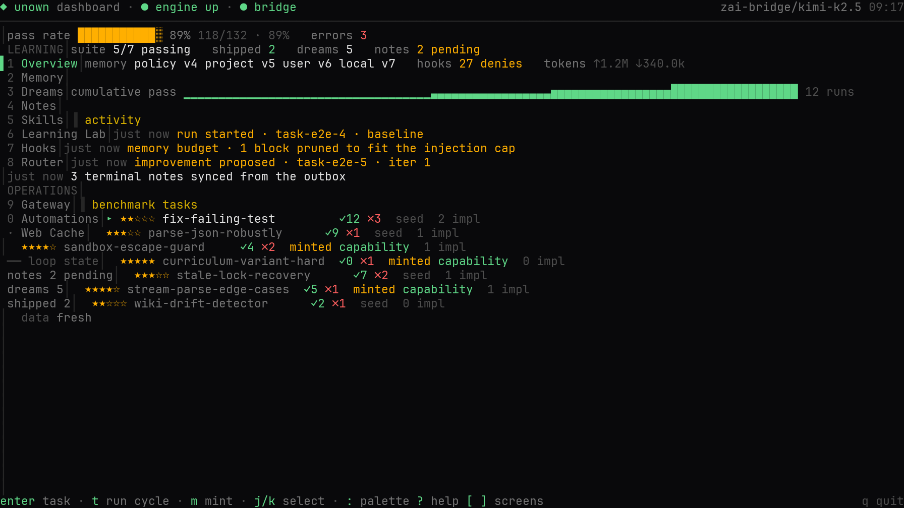
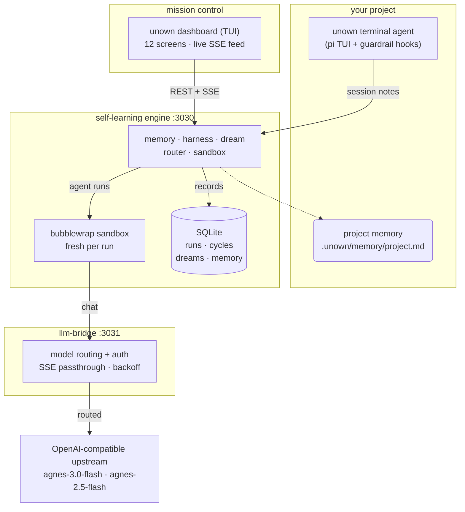
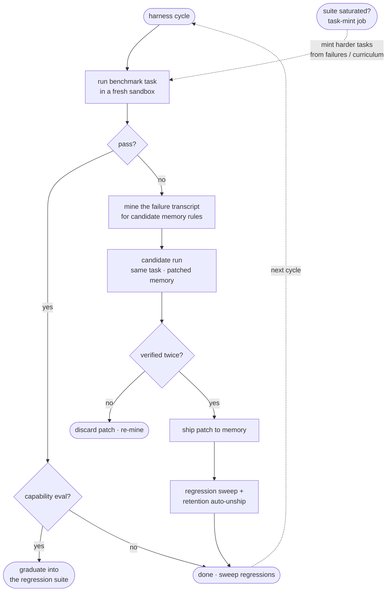
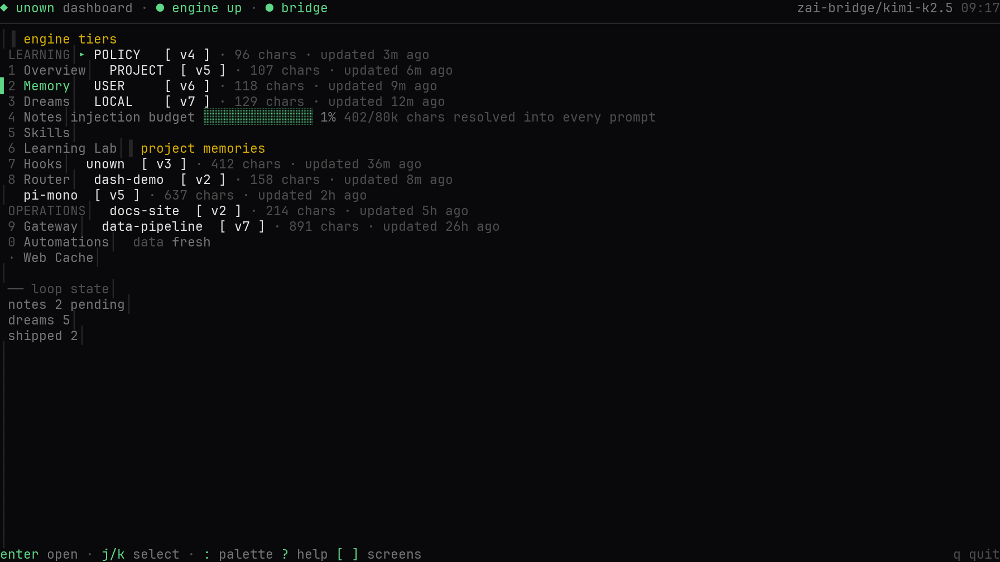
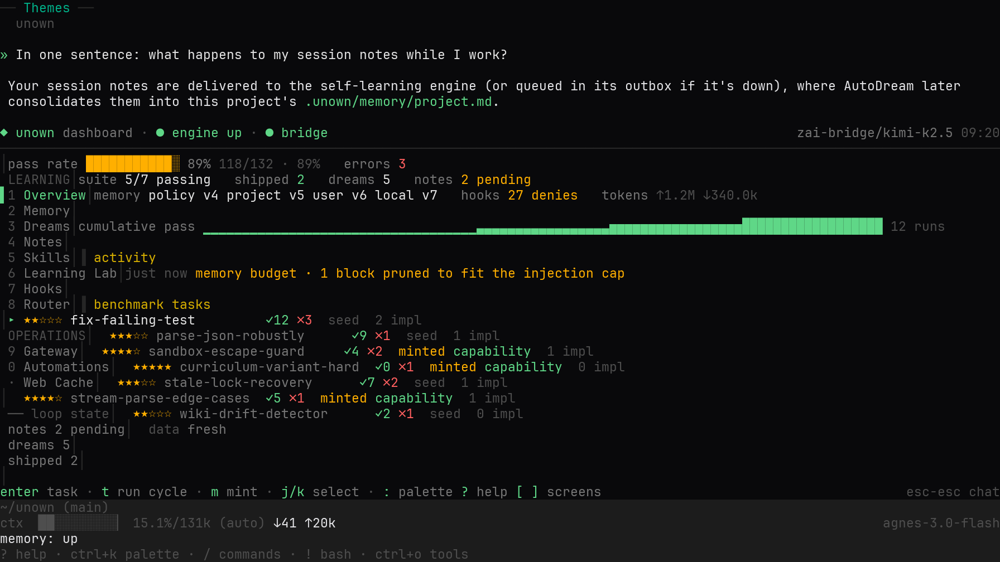
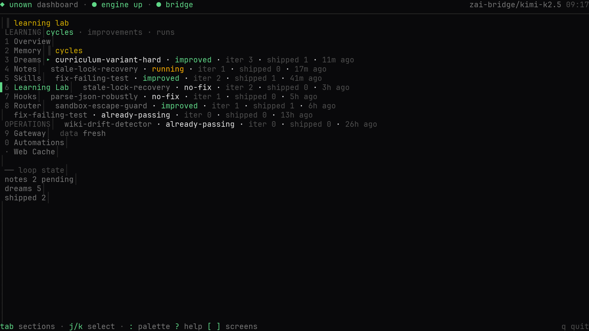
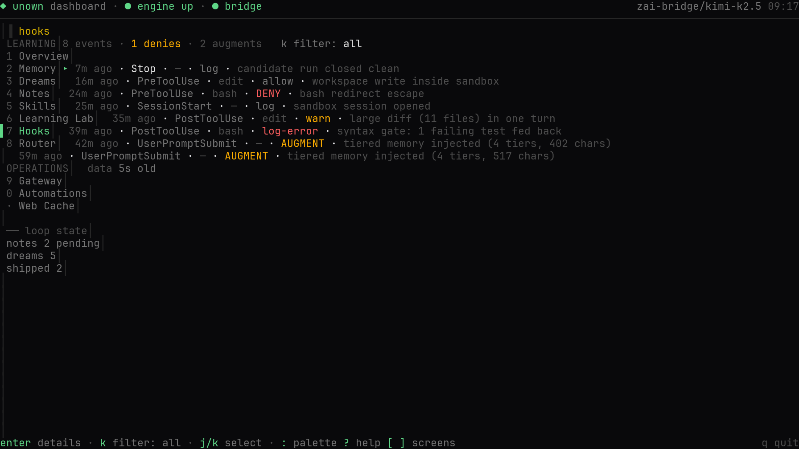

<p align="center">
  
</p>

# unown

Unown takes the open-source **[pi coding agent](https://github.com/earendil-works/pi)** and turns it into a full-fledged **self-learning agent**, applying the five mechanisms Anthropic popularized by *using Claude Code to improve Claude Code*:

> Let the agent find its own weaknesses. Let it fix them. Let it remember what worked.

Use it two ways:

- **In your terminal** — `unown` gives you a full interactive coding-agent session (the real pi TUI) in your actual project directory, with tiered memory injected, guardrail hooks active, and session notes captured for learning.
- **As a learning backend** — the engine runs as an independent daemon (`unown engine start` — or the full stack via `bun run agent:start`): harness cycles, AutoDream consolidation and background jobs continue in auto mode while you are away, within an hourly/daily LLM budget and under a job watchdog; your terminal sessions feed it notes (a down engine is auto-started on note delivery), and it writes improved memory back into your project. The two halves share nothing but files and HTTP — the terminal agent never opens the engine's database (measured: 0 fds; [design record](docs/detached-engine-architecture.md)).

<p align="center">
  <a href="https://github.com/kanishka-namdeo/Unown/actions/workflows/ci.yml"></a>
  <a href="https://scorecard.dev/viewer/?uri=github.com/kanishka-namdeo/Unown"></a>
  <a href="https://bun.sh"></a>
  <a href="https://www.typescriptlang.org"></a>
  <a href="LICENSE"></a>
  <a href="https://github.com/kanishka-namdeo/Unown/issues"></a>
</p>

**[Quickstart](#quickstart)** · **[Documentation](#documentation)** · **[Landing page](#landing-page)** · **[Dashboard tour](#mission-control)** · **[Architecture](#architecture)** · **[The learning loop](#the-learning-loop)** · **[Security](#security-model)** · **[What it learned](docs/memory.md#what-a-learning-session-looks-like)**



## The five mechanisms

| # | Mechanism | Where it lives | What it does |
|---|-----------|----------------|--------------|
| 1 | **Tiered Memory** | [`memory.ts`](pi-repo/packages/self-learning/src/memory.ts) · [`memzero.ts`](pi-repo/packages/self-learning/src/memzero.ts) · [`term.ts`](pi-repo/packages/self-learning/src/term.ts) | Four tiers — policy → project → user → local — merged most-specific-wins and injected into every agent session (engine sandboxes *and* terminal sessions). Every write is versioned, attributable (`seed` / `harness` / `mem0` / `rollback`) and rollback-able. The project tier runs on the [Mem0 memory platform](docs/memory-platform-swap-assessment.md) (in-process, SQLite-backed): rules ship in as atomic memories and the tier file is a deterministic render of them — still the committable artifact. **Scopes are repo-stable, not path-derived** ([`project-identity.ts`](pi-repo/packages/self-learning/src/project-identity.ts)): one repository = one memory across clones, renames, worktrees and machines; same-named directories never share a bank. `## Manual notes` in the project file is the hand-edit lane that survives every re-render; `/memory search <q>` recalls any project's learning from any session ([shared memory](docs/memory.md#shared-memory-across-sessions-and-projects)). |
| 2 | **Self-Improving Harness** | [`harness.ts`](pi-repo/packages/self-learning/src/harness.ts) · [`mint.ts`](pi-repo/packages/self-learning/src/mint.ts) | Runs a benchmark task → if it fails, mines the failure transcript → asks the LLM for memory rules that would have prevented it → re-runs a *candidate* with the patched memory → ships the patch only if it passes **twice** (candidate + confirmation — a noise gate) then sweeps for regressions. Shipped patches that later regress are automatically **un-shipped** (retention check). When the whole suite passes, **task minting** keeps the loop fed: it converts real failures — or LLM-authored harder curriculum variants — into new capability-eval tasks, which graduate into the regression suite once the agent masters them. Minted tasks must first prove themselves **solvable** (the draft's reference solution has to pass the task's own tests — an impossible task can no longer masquerade as a capability eval and burn a run every cycle), and a capability eval that keeps failing without ever passing is **quarantined** (deactivated, operator-reversible) instead of starving the loop forever. |
| 3 | **Routing** | [`router.ts`](pi-repo/packages/self-learning/src/router.ts) | Eight jobs keep the agent learning in the background: interval jobs `harness-cycle`, `task-mint`, `auto-dream`, `note-sync`, `sandbox-gc`, `db-retention`, plus event jobs on `improvement:shipped` and `run:finished` — with a busy-mutex so the sandbox is never double-driven. |
| 4 | **AutoDreaming + Skill Acquisition** | [`dream.ts`](pi-repo/packages/self-learning/src/dream.ts) · [`skills.ts`](pi-repo/packages/self-learning/src/skills.ts) | Session notes are consolidated through the Mem0 platform's extraction pipeline ([decision record](docs/memory-platform-swap-assessment.md)): benchmark notes into the engine's project memory (gated by a canary run — a dream that breaks the last-passing task is rolled back, memory version *and* platform event stream), terminal notes into **your project's own** `.unown/memory/project.md` (a deterministic render — pre-swap content imports verbatim at first dream). When the notes reveal recurring multi-step procedures, AutoDream also mints them as **Agent Skills** — concrete `SKILL.md` procedures staged into `.unown/skills-staged/` (never auto-loaded; promotion into `.unown/skills/` is a human `mv` — the 2026-10-22 hardening) — versioned and rollback-able — that the next session picks up through progressive disclosure. |
| 5 | **Hooks** | [`hooks.ts`](pi-repo/packages/self-learning/src/hooks.ts) · [`termhooks.ts`](pi-repo/packages/self-learning/src/termhooks.ts) | A pi inline extension enforcing guardrails at every layer. Always-on gates: `SessionStart`, `UserPromptSubmit`, `PreToolUse` (bash deny-list + path jail), `PostToolUse` (syntax gate that feeds errors back to the agent), `Stop`, `SubagentStop`. On top of them a user-configurable hook layer — `.unown/hooks.json` (project, trust-gated) + `~/.unown/agent/hooks.json` — honors **13 events** (adding `PreModelRequest`/`PostModelRequest`, `PreCompact`/`PostCompact`, `SubagentStart`, `TaskCompleted`, `PermissionRequest`) with five handler types (`command`, `http`, `mcp`, `prompt`, `agent`), in engine sandbox runs and terminal sessions alike. Every decision is logged. |

<p align="center">
  
</p>

Everything is observable from **mission control in your terminal** — `unown dashboard` (or `/dashboard` inside a live session) — with live SSE activity, run transcripts, memory version history, dream journals, hook decision logs, and the job router, on the same pi-tui stack as the agent itself.

## Architecture



The dotted edge is AutoDream writing consolidated memory back into your project. Each harness/task run deploys a **fresh sandbox** (isolated directory, jailed exec, OS-level [bubblewrap](https://github.com/containers/bubblewrap) isolation, tamper-proof sha256-verified tests), injects the resolved tiered memory into the agent's system prompt, attaches the hooks extension, streams the transcript back, verifies the result, and records a session note for the next dream.

## The learning loop

The harness is the heart of the system — a verify-gated loop that only ever ships memory changes a fresh sandbox has proven correct, and that keeps itself supplied with things it cannot yet do:



---

## Documentation

Full usage docs live in [`docs/`](docs/):

| Page | What it covers |
|---|---|
| [quickstart](docs/quickstart.md) | clone → install → connect a model → first session (5 minutes) |
| [install](docs/install.md) | the one-line installer, the source vs binary modes, manual and archive installs, requirements, offline/air-gapped installs, uninstalling |
| [updating](docs/updating.md) | mode-aware `unown update` (checkout and binary), the release manifest, per-OS availability, update notifications and the skip/snooze prefs, pinned installs, rollback, the privacy model of the update check |
| [update research](docs/update-research.md) | the 2026-10-21 survey and decision record behind the release feed and the update nudges (options, evidence tiers, reproduction commands) |
| [providers](docs/providers.md) | `unown setup`, models.json / auth.json / settings.json, the bridge vs direct endpoints, custom providers |
| [usage](docs/usage.md) | every command, slash command, keybinding, session tool, plan mode |
| [routines](docs/routines.md) | scheduled recurring agent runs — the five schedule kinds (cron / every / after / one-shot / events), completion anchors, misfire policies, failed-run retries, chained routines, timezone/DST edge cases, the TUI/CLI/tools management surfaces |
| [standing orders](docs/standing-orders.md) | `## Program:` sections — durable authority for unattended runs (two layers, budgets, Execute-Verify-Report loop) and `/promote`, the repeated-job-to-routine flow |
| [ralph](docs/ralph.md) | the worker/reviewer improvement loop — paired unattended sessions iterating a task with independent review |
| [repomap](docs/repomap.md) | the graph-ranked symbol map — aider's repo-map algorithm on a vendored tree-sitter, wired into subagent context |
| [watch](docs/watch.md) | `unown watch` — the AI comment watch: scan-triggered runs on AI-marked comments, hash-stable per comment |
| [split view](docs/split-view.md) | the split-view display mode — thinking/tool band, files dock, response-only transcript, every `/split*` command, `ui-panels.json` defaults |
| [addons](docs/addons.md) | the TUI addon framework: `ask_user_question`, `todo`, `advisor` — the addons.json schema, `/addons` configurator, keybindings, hot-reload semantics, design contracts |
| [subagents](docs/subagents.md) | the `task` tool, built-in `general`/`explore`/`background-explore`/`browser` (interactive web automation), authoring `.unown/agents/*.md` |
| [skills](docs/skills.md) | the Agent Skills format, the four starters, skills AutoDream mints on its own |
| [custom commands](docs/custom-commands.md) | authoring `.unown/commands/*.md` — frontmatter, `$ARGUMENTS`/`$1..$N` substitution, project + global scopes |
| [recipes](docs/recipes.md) | `unown recipes` + `/recipe` — declarative instruction bundles: typed parameters, `response_schema` structured output, file templates, sub-recipes |
| [repo wiki](docs/repo-wiki.md) | `unown wiki` + `/wiki` — auto-generated repo docs with `file:line` cross-links, DOT dependency graph, search |
| [ACP](docs/acp.md) | `unown acp` — the Agent Client Protocol server: drive the full agent from Zed and other ACP editors (JSON-RPC over stdio) |
| [permissions](docs/permissions.md) | the granular allow/deny/ask layer: config files, pattern semantics, trust gating, the hard-coded instruction-set write policy |
| [usage tracking](docs/usage-tracking.md) | `unown usage`, the bridge's usage log, cost estimates and price pinning |
| [web results store](docs/web-results-store.md) | the persistent cache behind web_search/webfetch — design record: exact-key vs semantic (H20), TTL + ETag revalidation, stale-if-error, the cacache model, prior art |
| [browser](docs/browser.md) | the `browser` session tool — drive a real Chromium over CDP: the work loop, the action reference, vision screenshots, launch vs attach, profiles and logins, the stealth tier (CDP-signal silence + coherent fingerprints + humanized input), the CAPTCHA pipeline, the env knobs |
| [memory](docs/memory.md) | the 4-tier memory stack, session notes, AutoDream consolidation on the Mem0 memory platform, the six integrity gates, [what a learning session looks like](docs/memory.md#what-a-learning-session-looks-like) |
| [the TUI observability round](docs/tui-observability-audit.md) | the TUI productization mission's records (2026-10-30): [the audit](docs/tui-observability-audit.md) (every surface judged against the seven questions — 22 flags, the OB-1..OB-8 benchmark tasks, the nine-level information architecture), [the competitor scorecard](docs/observability-competitor-research.md) (nine systems, the adopt/reject ledger), [the five user journeys](docs/observability-user-journeys.md), [the trust & transparency report](docs/unown-trust-transparency-report.md) (the 60-second measurement with receipts), [the UX principles card](docs/unown-ux-principles.md) (binding for future TUI work), the [resumable session log](docs/observability-round-session.md) and the [benchmark results](benchmarks/observability/RESULTS.md) |
| [cold-start validation](docs/learning-system-validation-report.md) | the Memory & Learning System Validation Programme's cold-start round (2026-10-29): a fresh clone + empty engine DB + one tracked memory file — the five mechanisms validated with receipts, the F1 recall-drift / F2 extraction-poisoning / F3 mint-caps failure chain found and fixed, the repeat-task lift (30 capped turns → 9), the retrieval recovery (0/6 → 6/6) — with the [memory effectiveness](docs/memory-effectiveness-report.md), [learning progress](docs/learning-progress-report.md) and [end-user experience](docs/end-user-experience-report.md) reports beside it |
| [memory-platform swap](docs/memory-platform-swap-assessment.md) | decision record: the learning core now runs on Mem0 (mem0ai OSS TS SDK) — why the bespoke ~4k-line engine went, the options table (Letta/Zep/Hindsight/Mastra), the implemented architecture, the Bun better-sqlite3 shim, migration/import, open risks |
| [detached engine](docs/detached-engine-architecture.md) | decision record: the self-learning engine as an independent daemon — the agent/engine responsibility split, twelve failure modes with mitigations, the budget governor, supervision (`unown engine`), before/after receipts ([benchmarks/detached-engine/](benchmarks/detached-engine/RESULTS.md)) |
| [detached-engine hardening](docs/detached-engine-hardening.md) | decision record (2026-10-26): the detached engine stays — the OpenAI codex-app-server-daemon / MemOS / Supermemory validation, the embedded-alternative rejection (bun#40659), and the six shipped hardening lanes: outbox dead-lettering, delivery retry, `/api/health` lifecycle phases, the in-flight drain registry, Windows pidfile recovery, cross-install token discovery |
| [detached-engine research](docs/detached-engine-research.md) | ~90 primary sources behind the design: Letta/Devin/Claude-Code memory systems, daemon supervision patterns, SQLite-as-queue, Bun daemon hazards |
| [detached-vs-embedded research](docs/detached-vs-embedded-research.md) | the 2026-10-26 landscape survey (54 sources): process models across agent-memory products, the OpenAI codex-app-server-daemon hybrid precedent, Bun cross-process SQLite hazards, systemd/launchd supervision state of the art |
| [engine resilience](docs/resilience.md) | failure-mode catalog + recovery playbook: engine down / crash-loop / corrupt DB / wedged / outbox overflow — the `memory:` footer states, `/engine`, the crash-loop circuit, `unown engine repair`, bounded-loss guarantees |
| [memory-classifier-evaluation](docs/memory-classifier-evaluation.md) | objective evaluation of Jev/GLiNER-style classifiers in the memory system |
| [memory-system-review](docs/memory-system-review.md) | the memory subsystem's critical review: findings F1–F10, each status-tagged with receipts where live, and the matrix for re-running them |
| [memory-competitor research](docs/memory-competitor-research.md) | the 2026-10-25 reverse-engineering sweep of eleven agent-memory products (Mem0/Letta/Zep/LangMem/Claude Code/Codex/Cursor/Cognee/A-MEM/MemOS/Supermemory): architectures, shipped-bug catalogs from their trackers, the comparison table, the top-10 improvement opportunities and the cross-industry failure modes to pin in the memory benchmark |
| [memory-competitor source deep-dive](docs/memory-competitor-source-deep-dive.md) | the 2026-10-26 source-level reverse engineering of ten repos at pinned SHAs (Letta V1+current, Mem0, Cognee, Graphiti, MemOS full+local, LangMem, Memobase, A-MEM): process models, write paths, background consolidation, crash behavior, 93 citations, and the top-10 transferable lessons behind the hardening round |
| [memory-eval SOTA round](benchmarks/memory-eval/) | the 2026-10-26 state-of-the-art memory evaluation suite, research-driven (LoCoMo / LongMemEval / MemoryAgentBench / MEME / MemBench surveyed first): ops-accuracy (gold-op ADD/UPDATE/DELETE/NOOP ledger, opsF1 0.992), retrieval-rank (platform search recall@k/MRR in two embedder arms — lexical vs onnx), judge-calib (the binary QA judge calibrated: agreement 20/20, FPR 0, flips 0/72), failure-modes (the competitor sweep's twelve documented failure modes pinned as measured regressions, 12/12) — receipts + honest limitations in each suite's RESULTS.md |
| [local-model research](benchmarks/local-llm) · [non-LLM research](benchmarks/nonllm) · [complementary research](benchmarks/complementary) | hypothesis testbenches for the learning layer: small local LLMs (llama.cpp lane, H1–H11), the zero-LLM tier (ONNX encoders + MinHash/LexRank/activation lanes, H9–H15 + campaign #2's Ettin-17m reranker / BM25+RRF fusion H23–H24 — H15 shipped as the engine's opt-in dream lanes, retired by the 2026-10-22 Mem0 swap; the H10/H11 ONNX lane lives on as the platform's embedder), and complementary local mechanisms (speculative decoding, semantic cache, H16–H22) — verdicts + receipts in each `results/REPORT.md` |
| [oh-my-pi-swap-assessment](docs/oh-my-pi-swap-assessment.md) | decision record: why the vendored pi harness stays, and what would reopen that call |
| [opencode-swap-assessment](docs/opencode-swap-assessment.md) | decision record: opencode clears both harness chokepoints, and is still not adoptable — why the blocker moved to the artifact |
| [sdlc-feature-parity](docs/sdlc-feature-parity.md) | decision record: which 2026-agent SDLC features (LSP, checkpoints/receipts, MCP, /review, /goal) were adopted, which stay out, and why — plus the hardening follow-ups |
| [sdlc-feature roadmap](docs/sdlc-feature-roadmap.md) | the 2026-10-19 forward roadmap — the reverse-engineering sweep across nine coding agents, synthesized into shipped-milestone order |
| [agentic asset workflow](docs/agentic-asset-workflow.md) | the gated pipeline that shipped the landing page's feature creatures — the repeatable process for the next visual-asset exercise |
| [configuration](docs/configuration.md) | every environment variable, `.env` semantics, state files layout, [production notes](docs/configuration.md#production-notes) |
| [windows guide](docs/windows.md) | native Windows: install, cmd/PowerShell shims, Git Bash + the powershell tool, sandbox story, WSL2 |
| [macos guide](docs/macos.md) | macOS: seatbelt sandbox notes, darwin prebuilds, install one-liners |
| [troubleshooting](docs/troubleshooting.md) | symptom → cause → fix (including `unown doctor` semantics) |
| [TUI capture workflow](docs/tui-capture-workflow.md) | how the landing page's terminal screenshots/video are captured from real sessions — the harness contract, geometry rules, audit gates |
| [blog](docs/blog.md) | the Unown blog at `/blog` — writing posts in `content/blog/`, the frontmatter reference, the media checklist per post type, the generator + RSS pipeline |
| [landing research](docs/landing-research.md) | the landing page's design rationale and claim-sourcing rules — why the page looks the way it does, and what keeps every number on it defensible |
| [landing effects research](docs/landing-effects-research.md) | the presence round's effect research — what the best dev-tool pages ship, what the UX research says works, and what this page rejected on contract grounds |
| [presence round session](docs/presence-round-session.md) | the presence round's resumable checkpoint log — setup, research, implementation, verification, release |
| [carving effects research](docs/landing-carving-research.md) | the carving round's effect research — the remainder of the same brief: the glyph draw-on, the AA-at-every-frame decode fill, the keycap chips, the WCAG 4.1.3 copy announcements, and the rejections that keep them honest |
| [carving round session](docs/carving-round-session.md) | the carving round's resumable checkpoint log — including the budget gates' determinism fix and the harness notes a future round will want |
| [website excellence research](docs/website-excellence-research.md) | the Website Excellence Round's design knowledge base — every elite-website token (Linear, Geist, Stripe) cited from live production CSS, the 2025–26 landing grammar, the VLM-critique literature, and the synthesis the round consumes |
| [website excellence gap analysis](docs/website-excellence-gap-analysis.md) | the platform's website-creation capability audit — what existed, what was missing, what the round built (`scripts/design_critic.mjs` + the rubric), and the open roadmap |
| [website excellence session](docs/website-excellence-session.md) | the round's resumable checkpoint log — the baseline receipt (overall 6.4/10, 23 font sizes, 32.7% off-grid), the critic calibration (known-bad 1.5), and the flagship build |
| [website excellence round 2 session](docs/website-excellence-2-session.md) | the second programme round's resumable checkpoint log — the fresh-clone baseline, the red-main diagnosis (F21: the release that shipped while its CI was red), and the round's capability builds |
| [website excellence gap analysis 2](docs/website-excellence-gap-analysis-2.md) | the round-2 capability audit — the round-1 roadmap closed or carried, the capability table (craft axes, brand-scoped personas, six skills, four agents, the ci-green gate), and the open roadmap |
| [website excellence research 2](docs/website-excellence-research-2.md) | the second research base — Apple, Airbnb, Notion, Framer, Raycast, Resend, Anthropic, Mercury, Attio read from live production CSS (optical tuning, token naming, fluid type, dark surfaces, warm paper, numbers-as-headlines), plus the 2026 motion state of the art and the ten enforceable rules |
| [ledger demo session record](docs/ledger-demo-session.md) | the receipt behind the gallery's ninth app — the round-2 validation website: the fintech dashboard built under the craft axes and website skills, green through the full critic rubric on iteration three, F24–F25 ledgered |
| [live demo session record](docs/live-demo-session.md) | the receipt behind the landing page's live-demo band — the kanban app the agent built, the four sessions that built it, the verification, and the documented embedding patches |
| [bazaar demo session record](docs/bazaar-demo-session.md) | the receipt behind the gallery's second app — the e-commerce round: the three SDLC sessions (plan, review, browser-QA), the findings each stage caught, and the nine embedding patches |
| [cadence demo session record](docs/cadence-demo-session.md) | the receipt behind the gallery's third app — the habit & streak tracker round: eleven agent sessions (plan, lib, api, ui, e2e, review, drill, landing, re-review), the findings each stage caught, the findings each stage caught, and the ten embedding patches |
| [parley demo session record](docs/parley-demo-session.md) | the receipt behind the gallery's fourth app — the multi-tenant support-inbox SaaS round (tenancy, auth, RBAC, isolation): twenty session boots, the adversarial review that found two P0 wall-breaks, the five skills AutoDream minted from the build's own procedures, and the eight embedding patches |
| [fugue demo session record](docs/fugue-demo-session.md) | the receipt behind the gallery's fifth app — the AI-workflow platform round: flows, runs, an inspector, and the round's embedding patches |
| [aria demo session record](docs/aria-demo-session.md) | the receipt behind the gallery's sixth app — the Enterprise CRM round (tenancy, weighted pipelines, forecast ladders, sequences, deterministic AI triage), running alongside the validation round as the Evolution Programme's proving ground |
| [nocturne demo session record](docs/nocturne-demo-session.md) | the receipt behind the gallery's seventh app — the AI-native incident-ops round (alert dedup + correlation, escalation timers, on-call rotations, SLA breach detection, a public status page, MTTA/MTTR analytics): 28 ledgered sessions, 104 files, 473 tests, the 10-step live browser pass 10/10 twice with zero console errors, and the F8–F13 failure chain found→fixed→pinned by the round's own lanes |
| [encore demo session record](docs/encore-demo-session.md) | the receipt behind the gallery's eighth app — the Website Excellence showcase: 17 ledgered sessions inside the measured design loop (the critique lane's receipts, the before/after slider, the five-receipt drift gate), every objective design gate green on the final build, F14–F18 ledgered |
| [aria round competitor research](docs/aria-round-competitor-research.md) | the aria round's delta sweep of the 2026 coding-agent field — Copilot's citation-verified cross-agent memory, Cursor's evals GA, Kiro's validation gauntlet, Conductor/OMP; the top-8 adopt list and the naming diligence that kept "Aria" |
| [parley round competitor research](docs/parley-round-competitor-research.md) | the parley round's six-system reverse-engineering (ZCode, OpenClaude, Codewhale, Goose, Crush, Amp) — the 2026 frontier is adversarial verification, isolation-controlled evaluation and durable resumable execution; five practices adopted |
| [TUI beautification plan](docs/tui-beautification-plan.md) | the evidence-based TUI design plan — VLM critique over the audited capture set, pixel-level color audit, defect-to-source traces |
| [TUI dashboard](docs/tui-dashboard-plan.md) | the terminal dashboard (`unown dashboard` / `/dashboard`) — the D-series design record: screens, both mounts, the live engine feed, and the web dashboard's retirement |
| [TUI responsiveness](docs/tui-responsive-plan.md) | the R-series responsive design record — viewport tiers, the min-size gate, footer degradation, overlay scaling, the graduated files dock |
| [behavior](docs/BEHAVIOR.md) | the agent behavior card: default models, memory stack, session tools, sandbox, hooks, and the behavior-change policy |
| [testing strategy](docs/testing-strategy.md) | the engineering contract for proving the harness works: which layers get which tests, what runs in CI, what must be true before a number may be published |
| [xplat testing](docs/xplat-testing.md) | the agent-drivable cross-platform lane — `scripts/xplat.mjs` + the `xplat.yml` dispatch workflow: four scenarios (smoke/core/full/release-verify), on-demand OS targeting, junit receipts, and the driving playbook |
| [benchmark research](docs/benchmark-research.md) | what comparable coding agents run and publish, and the Docker-free benchmarks Unown adopted for the landing page |

---

## Quickstart

### Prerequisites

- **The default binary install needs neither bun nor git.** The full-stack source install (`--source`) needs both:
- [bun](https://bun.sh) ≥ 1.4 — macOS/Linux: `curl -fsSL https://bun.sh/install | bash` · Windows: `powershell -c "irm bun.sh/install.ps1 | iex"` (then open a new terminal)
- [git](https://git-scm.com) (any build; on Windows the standard Git-for-Windows install is fine)
- An OpenAI-compatible LLM endpoint (see *Using a different model provider* below)
- **Windows, macOS and Linux** — the full agent and stack run on all three; OS-level engine sandbox: **Linux (bubblewrap) + macOS (seatbelt)**; native Windows uses the in-process path jail (WSL2 gives you kernel-grade isolation). See the [Windows](docs/windows.md) and [macOS](docs/macos.md) guides

### 1. Install

The default one-liner installs the **newest stable release binary** — the terminal agent alone, verified by SHA-256, with no git and no bun:

```bash
# macOS / Linux / WSL (POSIX sh)
curl -fsSL https://unown-nine.vercel.app/install.sh | sh
```

```powershell
# Windows (PowerShell)
irm https://unown-nine.vercel.app/install.ps1 | iex
```

For the **full stack** (terminal agent + engine + bridge, which is what makes Unown learn), add `--source` on POSIX or `-Source` on Windows — it clones the newest stable release tag and runs `bun run agent:install`:

```bash
curl -fsSL https://unown-nine.vercel.app/install.sh | sh -s -- --source
```

```powershell
irm https://unown-nine.vercel.app/install.ps1 -OutFile install.ps1
.\install.ps1 -Source
```

`--main` / `-Main` installs the edge branch; `--version vX.Y.Z` / `-Version vX.Y.Z` pins a stable release (see [Releases](https://github.com/kanishka-namdeo/Unown/releases)). PowerShell's `irm | iex` cannot pass flags — download `install.ps1` first to use them.

The manual source route pins the same tag:

```bash
git clone --branch vX.Y.Z https://github.com/kanishka-namdeo/Unown.git
cd Unown
bun run agent:install
```

(Plain `git clone` gives you `main` — the edge lane.) **The default binary is the CLI only** — it has no engine, bridge or dashboard data source; use the `--source` install for the learning stack ([docs/install.md](docs/install.md)).

The `--source` install runs `bun install --frozen-lockfile` at the root and in the bundled pi monorepo (`pi-repo/` — hydrating its provider model data on first run, ~1–2 min), builds it, creates `.env` from `.env.example` if missing, and puts `unown` on your PATH (a shim into `~/.local/bin` on macOS/Linux, `%USERPROFILE%\.local\bin\unown.cmd` + `unown.ps1` on Windows — see below). Windows: if the installer just changed your PATH, restart your terminal; PowerShell may need `Set-ExecutionPolicy -Scope CurrentUser RemoteSigned` once for the `.ps1` shim.

**Keeping it current:** `unown update` is mode-aware — a source checkout moves tag to tag (fast-forward only, never over uncommitted work), a binary install downloads and verifies the next release; `unown update --check` reports without changing anything — [docs/updating.md](docs/updating.md).

### 2. Connect a model

**One credential is required: an upstream API key.** Either wire the bundled bridge (recommended for the full stack — model routing, nothing secret on client machines):

```bash
# .env
BRIDGE_UPSTREAM_URL=https://apihub.agnes-ai.com/v1   # any OpenAI-compatible base URL
BRIDGE_UPSTREAM_KEY=<your key>
BRIDGE_KNOWN_MODELS=agnes-3.0-flash,agnes-2.5-flash
# optional: fail over to a second endpoint (e.g. a Dashscope or OpenAI account) when the primary cannot serve
# BRIDGE_FALLBACK_URL=https://dashscope.aliyuncs.com/compatible-mode/v1
# BRIDGE_FALLBACK_MODEL=kimi-k2.5

unown setup --provider bridge     # point the terminal agent at it
```

…or skip the stack entirely and use any provider directly:

```bash
unown setup --provider openai --api-key sk-... --model gpt-4o
# presets: openai · openrouter · anthropic · dashscope · deepseek · agnes · custom (any OpenAI-compatible endpoint)
unown setup                        # or the interactive wizard
```

`unown setup` verifies the endpoint and key before declaring success (probes speak each provider's own wire — Anthropic keys authenticate with `x-api-key`, and a 429 reports as *rate-limited* rather than unreachable), and writes `~/.unown/agent/{models.json,auth.json,settings.json}`. The model's specs — context window and max output tokens, the two numbers that drive compaction and the output cap — are **detected from verifiable sources** (the endpoint's own catalog, the curated table, models.dev, LiteLLM); when nothing verifiable knows the model, the wizard asks (validated prompts, with the receipt of what was tried), scripts carry `--context-window`/`--max-tokens`, and the session preflight gates first use — unown never guesses a spec silently. The interactive wizard is a guided flow: masked key entry (a stored key is shown as `key[:8]…` with Keep/Replace/Clear, and pasted keys get trim/whitespace hygiene), live model discovery from the endpoint on both the OpenAI and Anthropic wires, the spec step, a theme step, and a closing setup summary with first-task suggestions. On a fresh install, `unown` itself offers the same wizard once at first run — `Enter` opens it, `n` keeps the bundled bridge — and the first session then opens with the same **First flights** catalog inside the TUI: four starter tasks, one keypress each, retired by your first real message (`/flights` reopens it). See [docs/providers.md](docs/providers.md) and [docs/quickstart.md](docs/quickstart.md).

### 3. Start

```bash
bun run agent:start
```

Boots both services:

| Service | Default port | Health check |
|---------|--------------|--------------|
| llm-bridge | 3031 | `GET /health` |
| self-learning engine | 3030 | `GET /api/overview` |

The marketing landing page is not part of the stack: `bun run dev` serves it at :3000.

Logs land in `.run/*.log`; stop with `bun run agent:stop`. The launcher reads the bridge's `/health` (upstream key set? upstream answering?) and warns loudly instead of letting chats fail with a bare 401 later.

The engine also supervises itself out of the launcher: `unown engine status | start | stop | serve` (status reports pid, uptime, the active job and the governor's budget/breaker; `start` spawns a detached engine when down; `stop` drains gracefully — in-flight requests finish, the WAL is checkpointed, the lock releases; `serve` is the foreground entry a systemd user unit / launchd agent / Windows service should own). A terminal session auto-starts a down engine when it delivers its shutdown note, so the agent never needs the engine running to be useful — notes queue in the outbox and are drained at boot. Unattended learning is disciplined: every engine LLM call lands in a spend ledger with hourly/daily ceilings (`PI_ENGINE_MAX_CALLS_HOUR`…), consecutive upstream failures open an exponential backoff breaker, no router job may hold the engine past the job watchdog, and `unown doctor` reports all of it. Design record with measured before/after receipts: [docs/detached-engine-architecture.md](docs/detached-engine-architecture.md).

### 4. Use it in your terminal

`unown` runs the agent in your **real project directory** — the full pi TUI (file tools, bash, session management, `@file` mentions), plus the self-learning layer:

```bash
cd ~/code/my-project
unown                      # interactive session (like claude/pi, but learning)
unown "fix the failing tests"   # …optionally starting with a prompt
unown -p "explain the build error" | less   # one-shot headless (like claude -p)
unown --plan "add auth"    # plan mode: read-only exploration → numbered plan
unown setup                # connect a provider (wizard or flags; specs detected or asked)
unown models               # list configured models + spec provenance
unown models verify        # re-run spec detection; report anything unverified
unown doctor               # end-to-end diagnostics: endpoint, keys, upstream, memory
unown memory               # print the effective 4-tier memory stack
unown note "watch out: flaky test in auth.spec"   # hand AutoDream a note directly
```

Every session is pre-flighted: if the model endpoint is unreachable or rejects the credentials, you get the exact fix (start the stack / re-run setup) instead of a stack trace. Full command and keybinding reference: [docs/usage.md](docs/usage.md).

Every session ships with **Claude Code-grade session tools** on top of pi (the search trio `grep`/`find`/`ls` is default-active when their binaries are on PATH):

- **`todo`** — a live task-graph panel the agent maintains above the editor (and `/todos` to inspect it): a 4-state machine (`pending` → `in_progress` → `completed`, plus deleted tombstones), `blockedBy` dependencies with cycle rejection, `activeForm` progress labels, and completed rows that fade at the next turn boundary. State rides the session tree, so branching keeps the right list.
- **Addons** — three fully user-configurable TUI addons with one config file (`~/.unown/agent/addons.json`) and an in-session `/addons` configurator: `ask_user_question` (structured mid-run questionnaires — up to 4 tabbed questions, 2–4 options each, side-by-side previews, free-text and notes; the tool **blocks until you answer**, so the turn continues with your decision), the `todo` addon above, and `advisor` (a second model watching the session as compact per-turn deltas, verifying claims with read-only tools, and sending advice mid-run — nits queue as asides, concerns/blockers steer immediately; **off by default**). Ports of @juicesharp/rpiv-ask-user-question + rpiv-todo and oh-my-pi's advisor (all MIT). Full reference: [docs/addons.md](docs/addons.md).
- **`task`** — subagents with a **fresh context window** — eight built-ins (`general` full-tool, `explore` read-only, `background-explore` — the same read-only shape on a cheaper model at low effort, no MCP, no memory injection — plus `scout`, `worker`, `reviewer` and `planner` for the review/plan workflows, and `browser` — the interactive-web specialist that keeps DOM snapshots and screenshots out of your context and returns a verified report on a 10-minute budget) or your own `.unown/agents/*.md` definitions; run `/agents` to list. They are full unown agents: same memory, same guardrails — and their sessions write `[subagent]`-tagged notes, so **subagents learn too**. Up to 4 in parallel via `{tasks: [...]}`, with per-agent `model`/`effort`/`mcpServers`/`injectAgentsMd` routing, opt-in git `worktree_isolation` and `output_schema` typed replies (authoring guide: [docs/subagents.md](docs/subagents.md)).
- **`note`** — record a durable learning note **mid-session**; it reaches the engine immediately and AutoDream consolidates it into your project's memory (also `/note <text>`).
- **`/btw <question>`** — the side-question lane (the Claude Code / Antigravity / OpenCode 2026 consensus, ported): one answer about the session in a dismissible overlay — never entering the transcript, the receipts ledger or AutoDream's note mining. The context is the last 12 turns (text-only, capped); the answer dies with the overlay.
- **`/output-style [name]`** — the persona layer (Claude Code `/output-style` parity): built-ins `default` / `concise` / `explanatory` / `proactive` plus custom `.unown/styles/*.md`; the directive rides the system prompt from the next message, persists per project (`UNOWN_OUTPUT_STYLE` env wins).
- **`/insights [days]`** — cross-session analytics over your own history (Claude Code `/insights` parity): sessions, top models/projects, most-touched files (from receipts), tool usage, notes, token totals + the bridge window's cost, and friction (failed tool results). Everything local.
- **The 2026-10 convergence round** — seven workflows the October field shipped and unown hadn't (each reverse-engineered across Claude Code v2.1.295+, Crush v0.98, Goose v1.56, plus Gemini/OpenCode/Amp evidence): **OSC 7501 program status** (the session reports idle/working/blocked/clear to the terminal — the protocol Rex and Ghostty surface in the tab status; `PROGRAM_STATUS=0` opts out), a **per-turn footer meter** (`turn 3.4s · ctx 62% · in 45.2k out 1.1k (cached 42k) · ~$0.0084` — the /usage attribution + price model, live after every turn), the **`monitor` tool** (a bounded watch window over a real process — dev servers, log tails, test watchers — timestamped lines back as the tool result, with stop patterns, line caps and the bash deny-list), **`/review` team checks** (`.unown/review/checks/*.md` with `title`/`severity`/`model` frontmatter ride with the repo and run as extra parallel reviewers; `--severity`/`--checks`/`--dry-run`/`--list-checks`), **`/recap` + the auto-recap** (a deterministic welcome-home digest after a real idle gap — Claude Code's 3-minute rule — plus the on-demand LLM summary through the /btw lane), **idle compaction** (a session idle ≥45m at ≥50% context compacts itself before your next prompt — Claude Code v2.1.299), and **print-mode stall progress** (50/75/90% stderr milestones so a wedged upstream is never silent). Receipts: [`benchmarks/convergence-round/`](benchmarks/convergence-round/RESULTS.md).
- **The observability round** — the mission's primary metric made mechanical — *leave for 30 minutes, return, understand in 60 seconds* — via five composing surfaces, all receipts-only (the model never grades itself in chrome; every claim measured in [the benchmark](benchmarks/observability/RESULTS.md), principles codified in [docs/unown-ux-principles.md](docs/unown-ux-principles.md)): the **mission panel** (the pinned objective — an active `/goal`, else the `/mission` pin, else the session's own title; derived progress from plan steps or todos, else an honest absence; `conf ✓/◐/✗` from the session's own tool errors, verify failures and denials; the session cost/time rollup; composed risks, each with its fix), the **auto-brief on return** (after a real idle gap the next prompt gets eleven deterministic lines — `mission / happened / changed / last / why / conf / risks / learned / session / remains` — and it reports learning that happened *while you were away*; `/brief` adds the decision miner through the /btw lane), **`/recovery`** (the triage card: every failure classified once from the producers' own markers, worst-first, **each row with its repair path**, plus the `✗ N to fix` footer chip), **`/feed`** (the ambient learning feed: dreams, memory versions, harness improvements, consolidated notes — chip → card → dashboard), and the **dashboard Recovery screen** (mission control's twelfth screen, composing failed jobs, failed runs and recent denials from the existing screens' own data). `UNOWN_MISSION_PANEL=0` hides the ambient layer; the commands always answer. The audit, the nine-system competitor scorecard, the five user journeys and the trust report: [docs/tui-observability-audit.md](docs/tui-observability-audit.md) · [docs/observability-competitor-research.md](docs/observability-competitor-research.md) · [docs/observability-user-journeys.md](docs/observability-user-journeys.md) · [docs/unown-trust-transparency-report.md](docs/unown-trust-transparency-report.md).
- **Session auto-titles + turn-complete attention** — every interactive session names itself after its first settled turn (a cheap background call — never overwrites `/name`, `UNOWN_AUTO_TITLES=0` off), and a long turn (≥ `UNOWN_NOTIFY_MS`, shared with print mode) pings you when it's done: a deferred OSC-9 + BEL that never tears a frame (`UNOWN_TUI_NOTIFY=0` off).
- **`unown import` + `unown sessions import --from claude|codex`** — the migration moat, both halves: **configs** (`unown import --from claude-code|codex|gemini|cursor|opencode|auto`: instruction files append to `AGENTS.md` under a marked section, commands/skills/agents copy or convert, MCP servers merge into `.unown/mcp.json` — never overwrites, idempotent, `--dry-run`/`--list`/`--lane` to inspect) and **transcripts** (Claude Code project histories and Codex rollouts auto-detected, converted with fresh ids and a linear parent chain into `.unown/sessions/` for `/resume`) — leaving another agent is one command.
- **`fetch_url`** — read-only HTTP GET with HTML stripping and size caps.
- **`web_search` + `webfetch`** — **native web access** (the Claude Code / OpenCode surface, ported): ranked search results (title, URL, snippet) with provider auto-selection, then full page reads as text. Works **keyless out of the box** — DuckDuckGo → Tavily (keyless) → You.com → StackExchange → Wikipedia → HN, plus npm registry and GitHub repo search — and any of the 11 API-key providers (Tavily, Brave, Serper, Exa, Perplexity, Jina, Zhipu, DashScope, Kagi, SerpApi — and Firecrawl, which also serves the fetch side) prepends itself to the chain the moment its key lands in `.env`. Both tools are SSRF-hardened (private-address DNS resolution refused), robots-aware and size-capped; `allowed_domains`/`blocked_domains` filter results. `UNOWN_WEB_SEARCH=0` / `UNOWN_WEBFETCH=0` disable either. A **persistent web results store** (`~/.unown/cache/web/`, shared across sessions, subagents and automations) answers repeated queries from disk while fresh (search 60 min; fetches honor origin Cache-Control with ETag/Last-Modified revalidation — a 304 means "no version change" and re-serves the stored body) and serves the last good answer stale — always flagged — when every upstream attempt fails; every answer carries its provenance (`· cached (12m old)`). `unown webcache stats | clear | sweep` inspects it. Full provider table and key list: [docs/usage.md](docs/usage.md) · [docs/configuration.md](docs/configuration.md).
- **`browser`** — drive a **real Chromium** over CDP (no new runtime dependency): the agent navigates, reads the a11y tree with `[eN]` refs, clicks and types with trusted input (`isTrusted`-passing), fills forms in one call, watches console + network, takes screenshots **that come back as images the model sees** (the agnes preset takes them — the vision loop with `x`/`y` coordinate clicks), exports PDFs, and manages tabs, downloads and cookies. Auto-starts headless on first use (`UNOWN_BROWSER_HEADLESS=0` to watch it); a persistent profile at `~/.unown/browser/profile` keeps logins; `UNOWN_BROWSER_CDP` attaches to your already-running, already-logged-in Chrome. The work loop is navigate → snapshot → act on refs — every mutation returns a fresh snapshot so the next decision is grounded. For sites that fight back there is a **stealth tier** (`browser start stealth=true` / `UNOWN_BROWSER_STEALTH=1`): the Runtime domain is never enabled — the CDP detection signal (the 2026 bot-check that fires on `Runtime.enable`) stays **silent**, verified live in both directions — the fingerprint (UA, client hints, platform, timezone, locale, screen) is applied by the browser itself over the protocol with the *real* engine version, mouse paths and typing are humanized, and `browser stealth verify` re-reads the live fingerprint and reports all ten axes (10/10 coherent, and bot.sannysoft.com shows zero FAIL rows from a stealth session). A **CAPTCHA tier** rides along: `browser captcha detect|solve` classifies Turnstile/reCAPTCHA/hCaptcha/DataDome/AWS-WAF/image challenges and solves them through a native-click → 2Captcha/CapSolver → vision-OCR ladder (image captchas read by the repo’s own Agnes preset — verified live), with the vendor gaps stated rather than faked. The stress round (2026-10-26) hardened the real-world path: refs resolve through open shadow roots and same-origin iframes with the same trusted input (labels resolve in the element's own root, iframe boxes offset-compensated), tabs opened by `window.open` / OAuth popups are tracked with their real URLs and drivable end-to-end (tab bookkeeping moved from `Target.setAutoAttach` — which wedges popups mid-input on Chrome 143 — to discovery + explicit attach), native dialogs can finally be *answered* (`browser dialog accept text=green` arms a one-shot policy; `browser dialog list` reviews how each resolved), the deny-list gates `tabs new` and history too, concurrent downloads track by id, multi-modifier combos carry every bit, `fill_form` types humanized in stealth, and the 60k snapshot char budget is enforced. For anything beyond a quick check, delegate the whole flow to the **`browser` subagent** (`task {agent: "browser"}`) — the child holds the page noise, you get the `Outcome:/Did:/Pages:/Notes:` report. Full reference: [docs/browser.md](docs/browser.md) · the subagent lane: [docs/subagents.md](docs/subagents.md).
- **`lsp`** — language-server code intelligence (the oh-my-pi port): diagnostics, hover, go-to-definition, find-references and document symbols, with servers auto-detected on PATH (typescript-language-server, pyright, gopls, rust-analyzer, clangd, …) and configurable via `.unown/lsp.json`. After every write/edit the fresh diagnostics for that file ride the tool result — type errors get fed back to the agent instead of compounding (cold start never blocks; `UNOWN_LSP=0` disables). `/lsp` prints server status.
- **Post-edit auto-formatters** (OpenCode Formatters / aider auto-lint parity) — `~/.unown/agent/formatters.json` (user) and `.unown/formatters.json` (project, trust-gated): after every successful write/edit the first matching formatter runs (prettier, gofmt, ruff…; path appended or `$FILE`, 10s timeout) and the change feeds back to the agent as a `[PostToolUse:formatter]` block — the agent always sees the final on-disk form. Never overwrites an edit: missing formatters, timeouts and failures are fail-open and latch silent after the first notice.
- **Verify-first defaults** (the 2026-10 quality defaults, reverse-engineered from the top coding agents and IDEs) — the base system prompt carries the verify-first doctrine (read before editing, minimal changes, never weaken tests, run the project's checks before declaring work done), and after every write/edit of a non-doc file the agent runs the project's own check command — `typecheck`, else `lint`, detected from package.json / Makefile / pyproject — feeding failures straight back into the tool result (aider's auto-lint semantics: a broken edit is a failed edit; silent on pass, cooldown-throttled, fail-open; the command passes the same bash-policy denylist the bash tool answers to). `UNOWN_AUTO_VERIFY=0` disables the gate; `UNOWN_AUTO_TEST=1` opts the test suite into the same loop (off by default — tests can mutate state). The Tier-0 policy seed and `unown init`'s `AGENTS.md` carry the same guardrails. Details: [docs/BEHAVIOR.md](docs/BEHAVIOR.md).
- **`/plan`** (or `--plan`, or Ctrl+Alt+P) — plan mode: write tools disabled, bash allowlisted to read-only commands; the agent explores, produces a numbered plan, and you approve execution with live `[DONE:n]` progress.
- **`unown --worktree [name]`** (or `-w`) — main-session worktrees (Claude Code `--worktree` / Codex `--worktree` / Gemini `-w` parity): the session runs inside a managed git worktree at the repo's HEAD — parallel work without stashing. An untouched tree is removed on exit; a tree with changes is **kept for review — nothing is ever auto-merged** (`unown worktrees list|remove [--force]` manages the kept ones). Fail-closed outside a git repo.
- **Checkpoints + receipts** (the codewhale port) — every session keeps an audit ledger at `.unown/receipts/` (every prompt, tool call and result — blocked calls land as error results; `/receipts` prints it with totals) and seals automatic turn checkpoints (`.unown/checkpoints/`): `/undo [n|--all]` reverts the last n turns' file changes, `/checkpoint [label]` + `/restore` rewind to named snapshots, and `/redo [n|--all]` re-applies undone changes (the opencode/Cursor undo→redo port — any new checkpoint clears the redo stack). Restore is jailed to your project dir; both trees are gitignored.
- **MCP client** (the Claude Code / codewhale / zcode port) — any Model Context Protocol server configured in `.unown/mcp.json` or `~/.unown/agent/mcp.json` (stdio or streamable HTTP) connects lazily in the background and its tools appear in the session as `mcp__<server>__<tool>`. Failed servers never block the session; `/mcp` reports status and reconnects, `unown mcp` manages entries from the shell, and `unown doctor` covers the session surfaces too; `UNOWN_MCP=0` disables.
- **`/review`** (the oh-my-pi + Codex port) — parallel reviewer subagents over a frozen diff (uncommitted work or a base branch): P0–P3 findings with confidence and file:line citations, deduplicated across reviewers, one SHIP/DO-NOT-SHIP verdict (strictest wins), saved to `.unown/reviews/`.
- **`/goal` + `--goal`** (the zcode Goal Mode + muse goals port) — durable objectives with evidence-verified completion: the `[GOAL:COMPLETE]` tag contract rides every turn, the completion gate requires the tag + every todo done + ≥2 evidence markers, and goal state survives `/new` `/resume` `/fork`.
- **`/commit` + `UNOWN_AUTO_COMMIT`** (the aider/Codex port) — git-native commits without handing over a shell: `git add -A .` jailed to the project dir + `git commit -m` — **never pushes**. `/commit <message>` uses your message verbatim; bare `/commit` generates a conventional one from the session's latest reply (`unown(session): …`). Every unown commit closes with provenance trailers — `Generated-by: unown` + `Unown-Session: <id>` — so `git log --grep='Unown-Session: …'` leads straight back to the producing conversation (the Amp thread-ID pattern, wired to `/blame --session`). Fresh clones with no git identity still commit (per-invocation `unown <unown@local>` fallback, never written to config); your pre-commit hooks run; not-a-repo / clean-tree are friendly no-ops; subagents and automation runs never commit. Opt in with `UNOWN_AUTO_COMMIT=1` (**default off**) to snapshot pending work when a session ends (`unown(auto): session end snapshot <date>`). Details: [docs/usage.md](docs/usage.md#git-native-commits-commit).
- **Routines** (the zcode Automations port, grown recurrence semantics reverse-engineered from Todoist/Things/launchd/Quartz/k8s/GitHub-Actions — [docs/routines.md](docs/routines.md)) — scheduled recurring agent runs managed by the engine: `unown routines create --title 'morning brief' --every '1d at 09:00' --prompt "..."`. Five schedule kinds: **cron** (5-field, per-routine IANA timezone), **every** (schedule-anchored interval — day/week steps by wall clock, DST-safe), **after** (completion-anchored — re-arms N after each run *finishes*; regenerating, never overdue), one-shot, and **events** (`--on-event issue.opened --filter '...'` — webhook-triggered, URL-is-the-auth, flood-guarded). Per-routine **misfire policy** (skip-and-record, or launchd-style catch-up-once), **retry policy** (`--retry-max 3 --retry-backoff 600` — k8s backoffLimit semantics: failed occurrences re-run with doubling backoff, never consuming a slot or `--max-runs`; a day-old pending retry goes stale and is recorded), **chained routines** (every completion broadcasts the internal `routine.finished` event — `--on-event routine.finished --filter 'routineId == "…" status == "succeeded"'` runs the next hop, GitHub workflow_run style, 3-hop cap, the `routine.*` namespace unforgeable from outside), **monitoring/delivery** (`--active-hours`, `--idle-only`, `--deliver <url>` with the NO_REPLY quiet contract, `--jitter`), **until** end boundary, `--max-runs`; manage everything from the TUI (`unown dashboard routines`: wizard, field-editor, skip `s`, snooze `S`, streak row, live detail refresh), the CLI (`skip`/`snooze`/`edit`/`--json`), or the `routine_*` session tools. Default mode is **read-only** — the run gets read/grep/find/ls/todo/note/fetch_url/web_search/webfetch/lsp (web tools are read-only network reads — an unattended "morning brief" needs the web), no shell or writes; `--mode standard` (full toolset) must be explicit, and its changes land in your working tree for git review. Definitions live in the engine's database, never in the repo; runs carry `UNOWN_AUTOMATION=1` so a routine cannot schedule more routines; every run — and every skipped occurrence, with its reason — is recorded (`history`) with output, exit code, turns and tokens. Needs the engine (`bun run agent:start`). (`unown automations` still works as the historical alias.)
- **Skills** — four starter Agent Skills (`unown-self-learning`, `verification-first`, `methodical-debugging`, `repo-exploration`) are seeded into `~/.unown/agent/skills/`; drop per-project skills into `.unown/skills/<name>/SKILL.md` (pi implements the [Agent Skills](https://agentskills.io) standard, progressive disclosure included).
- **`/learning`** — re-print the effective 4-tier memory stack, fresh from disk.
- **`/context` + `get_context_remaining` + `view_image`** — the context tools, user-facing and model-facing: `/context` shows the utilization bar and where the window goes (the measured memory stack per tier, the conversation estimate, the system+tools residual, session rollups, compaction advice at 50/70/85%) — Claude Code `/context` / aider `/tokens` / Gemini `/stats` parity; `get_context_remaining` is the agent's own read of the same numbers; `view_image` is vision input for image-capable models (PNG/JPEG/GIF/WebP up to 4 MB, jailed to the project and tmp dirs).
- **`/blame`** — receipts-backed blame: `/blame <file>` shows which sessions and tool calls touched it (with `--session`/`--since`/`--json` filters); bare `/blame` summarizes the whole `.unown/receipts/` ledger (counts by tool, files written).
- **`/edit-resend`** — edit an earlier turn: `/edit-resend <n> "<new message>"` reverts files to the pre-Nth-user-message checkpoint (all-or-nothing) and resends your edited message as the new leaf; `/edit-resend list` prints the indices.
- **`/sessions` + `unown sessions`** — export a session to one self-describing JSON (manifest, messages, todos, notes, skills, files) or a shareable **markdown transcript** (`--format md`: metadata table, todos, notes, the conversation with tool-call bullets and fenced tool results — the Codex `/export` / goose `session export md` lane; secrets redacted by default, `--raw` opts out), rehydrate it on another machine, list what exists (`--all` drops the project filter). **Both stores are scanned** — the project's `.unown/sessions` imports *and* `~/.unown/agent/sessions` (where every real session is persisted, filtered to this project by the session header).
- **Recipes** (the goose port) — `unown recipes list|run|create|validate` and `/recipe <name> --key value`: markdown bundles in `.unown/recipes/*.md` (project) or `~/.unown/recipes/*.md` (user) pairing a task prompt with typed `parameters`, a `response_schema` the reply must satisfy (validated with corrective retries), file `templates`, `sub_recipes`, and `model`/`effort`/`allowed_tools` routing — [docs/recipes.md](docs/recipes.md).
- **Repo wiki** (the zcode port) — `unown wiki generate|search|list|show` and `/wiki`: parallel read-only subagents document every module with `file:line` citations into `.unown/wiki/` — index, module pages, a DOT dependency graph with cycle detection, a changes page and a `wiki.json` manifest; regeneration is deliberate (`--force`) — [docs/repo-wiki.md](docs/repo-wiki.md).
- **`/permissions`** — the granular permissions layer's status surface: mode, rule table with the file each rule came from, trust state, and `/permissions trust` to approve a project `.unown/permissions.json` ([docs/permissions.md](docs/permissions.md)).
- **`/init-agents` + `/doctor-instructions`** — generate an `AGENTS.md` from repo forensics (in-session preview; `unown init-agents` writes it — `--print` to stdout, `--overwrite` to skip the prompt) and audit the whole instruction set — AGENTS.md freshness, skills, MCP orphans, hooks schema, adversary mode, injection scanner (`unown doctor-instructions --json` for the machine-readable report).
- **Routing + CI flags** — `--model <id>`, `--effort low|medium|high`, `--mcp-servers <csv>`, `--no-agents-md` on any launch (TUI or print mode): per-session model, reasoning-effort, MCP-whitelist and memory-injection routing — the same knobs agent definitions use per-subagent; `UNOWN_SUBAGENT_MODEL` re-points every subagent at once ([docs/subagents.md](docs/subagents.md#per-agent-routing)). Headless hardening: `--max-turns N` (bounded run), `--output-schema <file>` (validated final answer) and `--max-tool-repetitions N` — the **loop guard** (goose parity): the same tool called with the same arguments N times in a row aborts the run with a distinct exit code. Print-mode exit contract: **0** success · **1** error/empty · **2** usage · **3** schema-invalid · **4** loop guard tripped.
- **User-configurable hooks** — `.unown/hooks.json` (project, refuse-first trust-gated via `/hooks trust`) and `~/.unown/agent/hooks.json`: **13 events** (`SessionStart` … `PermissionRequest`) with five handler types (`command`, `http`, `mcp`, `prompt`, `agent`) that run in terminal sessions too — plus adversary mode (`~/.config/unown/adversary.md`), an LLM reviewer that re-checks destructive bash/write/edit calls when the gate file exists.
- **ACP** — `unown acp` runs the Agent Client Protocol server (JSON-RPC over stdio): drive the full agent — sessions, tools, guardrails, learning — from Zed and other ACP editors — [docs/acp.md](docs/acp.md).
- **Usage tracking** — `unown usage`: token/cost report from the bridge's request log (`--days`, `--model`, `--json`) — [docs/usage-tracking.md](docs/usage-tracking.md).

What the terminal session does for you:

- **Memory** — the resolved stack (global policy → your project's `.unown/memory/project.md` → global user memory → `.unown/memory/local.md`) is injected into every session (re-read on each `/new` `/resume` `/fork`, so AutoDream's updates land without a restart), alongside your own `AGENTS.md`/`CLAUDE.md` chain if present.
- **Skills that grow themselves** — when your session notes keep describing the same multi-step procedure (how to run this test suite, how to deploy, how to debug the flaky part), AutoDream mints it as an Agent Skill into `.unown/skills-staged/<name>/SKILL.md` — versioned in the engine, rollback-able and retire-able from the dashboard — and, once you promote it into `.unown/skills/` (a one-line `mv`; staged skills are never auto-loaded — the 2026-10-22 hardening), the very next session can use it (progressive disclosure: only the name + description ride the prompt until needed).
- **Guardrails** — catastrophic commands (`rm -rf /`, fork bombs, disk formats) and out-of-project writes are blocked before execution; the agent also cannot write its own rule files — in-session writes to `AGENTS.md`, `.unown/skills/**`, `.unown/hooks.json`, `.unown/permissions.json` and the other instruction-set shapes are denied (propose a PR instead); broken JS/TS you (or the agent) write gets the transpiler error fed back instead of compounding. Normal work — network, `git push`, package installs — is allowed. Set `UNOWN_STRICT_HOOKS=1` for sandbox-grade strictness.
- **Learning** — when you exit, a session note is delivered to the engine; AutoDream consolidates your notes into an updated `.unown/memory/project.md`, so the next session starts where the last one ended. Notes queue in `~/.unown/notes/outbox/` when the engine is down and sync automatically later.

Re-link the command from a source checkout (optional):

```bash
bun run agent:link         # writes a `unown` shim into ~/.local/bin → this checkout
                         # (Windows: %USERPROFILE%\.local\bin\unown.cmd + unown.ps1,
                         #  and appends the dir to your user PATH)
```

A shim (not `bun install -g .`) is the supported global-install path: it keeps the vendored pi workspace resolution and subagent spawning intact. Re-run it after moving the repo. Full reference: [docs/usage.md](docs/usage.md).

### 5. Watch it learn

Run **`unown dashboard`** (fullscreen TUI) — or **`/dashboard`** inside a live session (Esc-Esc returns you to the editor):

- **Overview** — pass rate, shipped improvements, dream count, memory version, hook decisions, token usage, and the live activity rail.
- **Memory** — the four tiers, their contents, full version history and one-key rollback — plus per-project tiers and the Agent Skills AutoDream minted into your projects (with rollback and retire).
- **Learning Lab** — every harness cycle: baseline run → failure diagnosis → proposed memory patch → candidate run → ship/reject, with full transcripts.
- **Dreams** — AutoDream sessions: merged / pruned / added notes and the consolidated memory they produced.
- **Notes** — the raw session-note inbox AutoDream consolidates from.
- **Skills** — the skill library with versions, rollback and retire.
- **Hooks** — the decision log of every guardrail (allow / deny / augment).
- **Router** — background jobs: enable/disable, trigger manually, see run counts and next-fire times — plus the sandbox inventory.
- **Gateway** — the llm-bridge request log: per-model traffic, tokens, latency, errors.
- **Routines** — scheduled recurring `unown` runs (cron, every, after, one-shot): create wizard, field editor, run now, skip/snooze, pause/resume, per-run history with streaks.
- **Web Cache** — the persistent web results store: entries, hits, saved tokens.

Number keys jump between screens, `?` opens the help card, and the same screens are reachable from a live session without leaving the editor.

The engine seeds itself on first boot: default memory tiers, five benchmark tasks (`fizzbuzz`, `impl-debounce`, `map-limit`, `drop-right`, `fix-csv-parser`), and the router jobs. Leave it running and the `harness-cycle` job will keep mining failures and shipping memory improvements on its own.

---

## Landing page

`bun run agent:start` brings up the stack (bridge + engine) and `bun run dev` serves the **marketing landing page at `/`** — mission control is `unown dashboard`, not a web page.

The landing page is built around the name. Unown is the Symbol Pokémon — a flat black letter with one eye, alive since 1999, found on the walls of ruins reading what is written there — and `unown` is a pun you have to read twice. So the page carries a **28-form alphabet drawn from scratch for this project** (inline SVG, no font file, no sprite sheet): hover or focus any form in the wall to decode the lore it borrows and the real mechanism it stands for here.

Since the presence round (2026-10-28) the page also *answers* the visitor: the hero kicker decodes once through the letters of UNOWN, the headline's words settle into place, a gold route bar scrubs with your reading, the nav marks the band you are in, and the proof cards light up under your pointer — six effects, every one additive, every base state finished, every one verified in both motion states (the research and the reasoning: [`docs/landing-effects-research.md`](docs/landing-effects-research.md)).

Since the carving round (2026-10-28, v0.0.37) the page also *carves*: the alphabet decode panel's glyph draws itself when you first reach it and re-carves on every hover, the finale spellbox's letters carve themselves as you type (the draw drives the `Glyph` component's long-unwired stroke-reveal contract), the finale lead resolves word-by-word from faint to dim as you read it (a scroll-scrubbed color fill that stays AA at every frame), the Konami affordances wear keycap chips, and every copy button now announces "Copied" to screen readers (WCAG 4.1.3). The same round made the scroll-budget gates deterministic — measuring the session replay at its finished state and counting readable words once — so both gates agree: 13.3 viewports / 3,153 words against the 13.5 / 3,320 budget (the research: [`docs/landing-carving-research.md`](docs/landing-carving-research.md)).

The page's centerpiece is the **capability dex** — every catalogued capability on one numbered spine (the drawn creature forms and the filmed surfaces), browsed a screen at a time by category, searchable, deep-linkable at `#dex-<id>`, every entry carrying its filmed capture plus receipt links into this repository (24 movies, zero stills, zero pending — the media gates pin all three). And the page **runs what the agent builds**: the live-demo band is a switchable gallery of agent-built apps — `/demo` (Sigil Focus, a fullstack kanban + focus-timer app; one unown session, ~200 tool calls, 27 tests, zero human edits to the app's code), `/bazaar` (Sigil Bazaar, a fullstack e-commerce app — storefront, checkout wizard, owner analytics — planned, reviewed and browser-QA'd by the agent itself across three SDLC rounds; 838 tool calls, 88 tests, a SHIP verdict; the record is [`docs/bazaar-demo-session.md`](docs/bazaar-demo-session.md)), and `/cadence` (Cadence, a fullstack habit & streak tracker — planned, reviewed, browser-QA'd and embedded by the agent across the round; 1,381 tool calls, 96 tests, the record is [`docs/cadence-demo-session.md`](docs/cadence-demo-session.md)), `/parley` (Parley, a multi-tenant customer-support inbox SaaS — tenancy behind a fail-closed repository, real scrypt/session-cookie auth, a four-role RBAC matrix, SLA countdowns, invites with a demo mailbox, an audit log and usage metering; 1,109 tool calls across 20 boots, 302 tests, an adversarial review that found and pinned two P0 wall-breaks, the record is [`docs/parley-demo-session.md`](docs/parley-demo-session.md)), and `/fugue` (Fugue, an AI-workflow platform — flows, runs, an inspector; the record is [`docs/fugue-demo-session.md`](docs/fugue-demo-session.md)) — each running live in the visitor's browser, sandboxed, lazy-mounted, with a working per-app reset and a full-screen escape hatch; the kanban round's record is [`docs/live-demo-session.md`](docs/live-demo-session.md). No other terminal coding agent ships a live, interactive agent-built demo on its landing page — let alone five. The numbers, the per-screen counts and every tally on the page are derived from the data, never typed. The whole search surface is derived and gated the same way — canonical, sitemap, robots, OpenGraph and a JSON-LD graph (`Organization` + `SoftwareApplication` + `FAQPage`) — asserted against the build by `e2e/seo.spec.ts` and against the deployment by `scripts/verify-deploy.mjs`.


Every number and every quoted artifact on that page is checkable, nothing from a Pokémon release is bundled or reproduced, and the page says plainly that it is an independent project. The design rationale, the lore sourcing rules and the asset licences are in [`docs/landing-research.md`](docs/landing-research.md); the section contracts are in [`src/components/landing/AGENTS.md`](src/components/landing/AGENTS.md).

---

## Mission control

The dashboard is a live window onto the engine — every number below is real data from a running instance, streamed over SSE. It lives where the rest of the product lives: **in your terminal**. `unown dashboard` opens the fullscreen TUI; `/dashboard` embeds the same screens inside a live session; `unown dash` is the short form ([docs/tui-dashboard-plan.md](docs/tui-dashboard-plan.md) — the design record, including the web dashboard's retirement).


| | |
|---|---|
|  |  |
|  |  |

The twelve screens: **Overview** (KPI band, benchmark task table, live activity rail) · **Memory** (the four tiers + project tiers, budget meter, version history, rollback) · **Learning Lab** (harness cycles, improvements, runs and transcripts) · **Dreams** (AutoDream sessions and pending notes) · **Notes** (the session-note inbox) · **Skills** (the self-minted library) · **Hooks** (the guardrail decision log) · **Router** (background jobs + sandboxes) · **Recovery** (the observability round's triage: failed jobs, failed runs and recent denials, worst-first with drill-ins) · **Gateway** (bridge health and upstream) · **Routines** (scheduled recurring runs) · **Web Cache** (the persistent web results store). Provider management is one screen away too — `/providers` in a live session, `unown providers` on the CLI ([docs/providers.md](docs/providers.md)).

Stills are PTY captures of real `unown dashboard` sessions (pane-audited; the capture lane is [scripts/tui-capture/](scripts/tui-capture/)).

## Configuration

All variables are optional with sane defaults; author `.env` from [`.env.example`](.env.example). The **full reference** — engine, bridge, landing, terminal and sandbox variables, `.env` loading semantics, state files and agent config files — lives in [docs/configuration.md](docs/configuration.md), alongside the [production notes](docs/configuration.md#production-notes) (run the engine without hot reload, put `BRIDGE_API_KEY` on the bridge, scale by running more single-tenant instances).

### Using a different model provider

The bundled `llm-bridge` turns **any OpenAI-compatible upstream** (Agnes AI, Dashscope, OpenAI, OpenRouter, vLLM, llama.cpp server, …) into a local endpoint the pi agent can use: it injects upstream authentication, routes requested model ids onto its allow-list, translates `thinking` flags for qwen models, passes tool calls and image content through natively, streams SSE back untouched, and serializes/throttles/retries requests. Or skip the bridge entirely — `unown setup` connects the terminal agent straight to any provider (see [docs/providers.md](docs/providers.md)).

```bash
PI_BRIDGE_URL=https://api.openai.com/v1 \
PI_MODEL_ID=gpt-4o \
PI_PROVIDER=openai \
bun run agent:engine
```

## Security model

- **Sandboxes (OS-level)**: every engine run — verify scripts *and* the agent's own bash commands — executes under the OS sandbox: **bubblewrap** on Linux (read-only root filesystem, private `/home` `/tmp` `/run`, killed network namespace, dropped capabilities) and **seatbelt (`sandbox-exec`)** on macOS with a bwrap-equivalent profile. **Native Windows has no OS sandbox** — engine runs there use the in-process path jail, the same degradation Claude Code ships on native Windows (WSL2 gives you kernel-grade isolation). A verified bwrap binary is vendored in `pi-repo/packages/self-learning/native/` with recorded sha256 provenance (Linux only). Set `UNOWN_OS_SANDBOX=0` to disable, `UNOWN_SANDBOX_NET=1` to keep the network shared.
- **Sandboxes (process)**: executed commands are jailed to the workspace with timeouts and output caps; benchmark tests are sha256-pinned so the agent cannot tamper with verification.
- **Hooks (engine)**: `PreToolUse` denies destructive shell (`rm -rf /`, `sudo`, outbound `curl`/`wget` to external hosts…), the path jail blocks escapes, and the `PostToolUse` syntax gate feeds transpiler errors back to the agent instead of letting broken code compound.
- **Hooks (terminal)**: the same gate protects interactive sessions but scoped for real work — catastrophic commands and writes outside your project/`/tmp` are blocked; network, `git push` and installs stay available. `UNOWN_STRICT_HOOKS=1` restores the sandbox-grade policy.
- **LLM bridge**: optional bearer auth, request serialization and rate-limit backoff.
- **No secrets in the repo**: the engine reads credentials from its environment at runtime.

**October 2026 hardening** (landed 2026-10-22, research-driven — the instruction set itself was the one unprotected surface):

- **Instruction-set write policy** — in-session writes (write/edit tools *and* bash redirects) to `AGENTS.md`/`CLAUDE.md` at any depth, `.unown/skills/**`, `.unown/agents/**`, `.unown/hooks.json`, `.unown/permissions.json`, `.unown/memory/policy*`, `.claude/settings.json`, `.claude/agents/**`, `.vscode/{tasks,settings}.json` — and, since the same-day v2 extension, `.unown/memory/project.md` + its provenance sidecar — are denied: verdict final, above the declarative permissions layer; the message says to propose a PR ([permissions](docs/permissions.md#instruction-set-write-policy-2026-10-22-hardening); `pi-repo/packages/self-learning/src/instruction-guard.ts`, wired in `termhooks.ts` + `hooks.ts`).
- **Memory-lane hardening (provenance v2)** — the Manual-notes preservation feature made agent-written memory durable, so `project.md` (tier-1, injected into every future session) and its honesty sidecar joined the deny table: a hijacked agent can no longer plant a rule that survives dreams, and a forged sidecar can no longer vouch for content AutoDream never wrote. The dream sidecar records the preserved section's sha256 plus a sticky `manualEdited` flag, so a preserved hand-edit is framed `Manual notes section hand-edited, unverified` forever — never laundered into “written by AutoDream” (the class arXiv:2607.29167 *Memory Provenance Laundering in LLM Agents* formalizes; OWASP ASI06). Hand-edits outside sessions keep surviving dreams verbatim, capped at 4k chars (`instruction-guard.ts`, `dream.ts`, `term.ts`, `memzero.ts`).
- **Staged skill minting** — AutoDream mints into `.unown/skills-staged/` (never auto-loaded; promotion into `.unown/skills/` is a human `mv`), so no model-authored skill rides the prompt unreviewed (`skills.ts`).
- **TOCTOU re-check** — a user `PreToolUse` hook that *mutates* tool input gets the full built-in gate stack + permissions layer re-run on the mutated input; what you approve is what runs.
- **DNS-exfiltration deny rules** (CVE-2025-55284) — `ping`/`ping6`/`nslookup`/`dig`/`host` (+ PowerShell `Test-Connection`/`Resolve-DnsName`) to external targets denied in sandbox + strict modes, loopback exempt (`bash-policy.ts` `BASH_DENY`, `termhooks.ts` `STRICT_EXTRA_DENY`).
- **Fail-closed sandbox knob** — `UNOWN_SANDBOX_REQUIRED=1` makes engine runs refuse to start (typed `SandboxRequiredError`) instead of degrading to the path jail when the OS sandbox is unavailable (`bwrap.ts`, `sandbox.ts`, `runner.ts`; documented in [`.env.example`](.env.example)).
- **GitSpawn hardening** — every read-only git probe neutralizes `core.hooksPath` (empty dir), `core.fsmonitor`, `core.sshCommand`, `core.askPass` and `core.pager` with `--no-optional-locks`; `git add`/`commit` keep user hooks live (the husky contract) but still neutralize the exec sinks (`gittools.ts`, applied across `worktree.ts`/`info.ts`/`uninstall.ts`/`update.ts`; September 2026 GitSpawn disclosure).
- **Invisible-Unicode lint** — `scripts/check_instruction_chars.mjs` (7 backdoor char classes: Unicode Tags, Trojan-Source bidi, zero-width, soft hyphen, Sneaky-Bits operators, VS runs) over every instruction file, in CI (`instruction-chars` job), pre-commit (gitleaks v8.30.1 + local hook) and `unown doctor-instructions`'s Unicode-integrity audit.
- **CODEOWNERS + branch protection** — instruction files, guard/gate sources and CI/secret-scanning config require owner review; `main` requires PR + review + 7 CI checks + linear history, no force push.
- **Static-analysis & supply-chain round (2026-10-23)** — every Dependabot and CodeQL code-scanning alert cleared in one audited pass: all six workflows re-pinned to SHA-verified current action versions (`actions/checkout` v7.0.1, `attest-build-provenance` v4.2.2, no floating tags left); every npm advisory in the vendored `pi-repo/` tree bumped at the lockfile level (undici 6.29.1, vite 8.3.5, vitest/@vitest/mocker 4.1.12, shell-quote 1.12.0, source-map-js 1.2.2, brace-expansion 5.0.12, and `@earendil-works/gondolin` 0.12.0 → 0.13.0 — 0.14.0 removes node-forge entirely but respects this repo's `min-release-age=2` supply-chain gate until 2026-10-24; the two no-fix node-forge advisories are dismissed as `fix_started` with that upgrade documented as the follow-up); and all 50 open CodeQL findings fixed at the source — polynomial-redos regexes rewritten as machine-verified linear equivalents (97k exhaustive `parseDiffLine` strings, 111M `substituteArgs` match-sequences, zero behavioral drift), substring URL/host checks replaced by parse-then-compare (the `https://evil.net/x/api.openai.com` misclassification class), git remotes/refs scheme-validated with `--` end-of-options separators (the `--upload-pack` RCE vector), stack traces barred from API responses, session ids moved to `node:crypto`, and the websearch HTML-to-text lane made re-formation- and double-unescape-proof. Two `stdioSpawnSpec` env-injection findings were assessed false positives and dismissed with the five-layer defense cited (CRLF/NUL/`%`/metachar refusal + cross-spawn escaping + quote-wrapped `/c` line).
- **Security round (2026-10-27, v0.0.30)** — the advisory surface back to zero, again by fixing causes: undici 8.12.3 (the 8.12.2 security release — content-encodings DoS, EventSource parser memory, SRI bypass; release notes read per the pi-repo contract, no breaking changes on the dispatcher's surface); zod forced to 4.6.7 through npm `overrides` at the monorepo root (it is transitive-only — `mem0ai`, `@anthropic-works/sandbox-runtime`, the `openai` peer — so the override is the only lever, and the engine suite re-ran green with the memory tier on zod 4); gondolin 0.14.0 (the node-forge follow-up above, now shipped — node-forge is gone from every manifest); the three remaining CodeQL findings closed (the captcha tier's interpolated `pageEval` moved to the argument-passing `pageCall` primitive, two identity no-op replacements removed with pinning tests); the CI actions re-pinned (`upload-artifact` v7.0.2, `setup-node` v7.1.0, `harden-runner` v2.22.2, every SHA verified against its release tag); and `bun.lock` regenerated with the CI-pinned bun after the round's one incident — a bun older than the repo's 1.4 floor had silently downgraded the lockfile format and dropped the nested overrides, which the 3-OS frozen-install gate now catches structurally. `npm audit` reports 0 vulnerabilities across the vendored tree; zero open Dependabot and code-scanning alerts.
- **Single lockfile** — root `package-lock.json` removed; `bun.lock` is the one source of truth. GitHub secret scanning + push protection enabled on the repo.

The six **learning-integrity gates** that police self-modification (ship gate, mint gate, dream canary, retention check, skill mint gate, full version history) are documented in [docs/memory.md](docs/memory.md#learning-integrity-how-the-system-polices-itself).

## Credits

- [earendil-works/pi](https://github.com/earendil-works/pi) — Mario Zechner's pi coding agent (formerly badlogic/pi-mono; the old URL redirects), bundled and extended here.
- The five self-improvement patterns popularized by Anthropic's engineering blog on improving Claude Code with Claude Code.
- Unown v1 — the Claude Code harness blueprint this project grew out of — is preserved under [`blueprint/`](blueprint/) as reference material.

## License

MIT — see [LICENSE](LICENSE).
