<p align="center">
  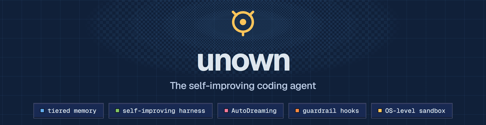
</p>

# unown

Unown takes the open-source **[pi coding agent](https://github.com/badlogic/pi-mono)** and turns it into a full-fledged **self-learning agent**, applying the five mechanisms Anthropic popularized by *using Claude Code to improve Claude Code*:

> Let the agent find its own weaknesses. Let it fix them. Let it remember what worked.

Use it two ways:

- **In your terminal** — `unown` gives you a full interactive coding-agent session (the real pi TUI) in your actual project directory, with tiered memory injected, guardrail hooks active, and session notes captured for learning.
- **As a learning backend** — the engine keeps running harness cycles, AutoDream consolidation and background jobs; your terminal sessions feed it notes, and it writes improved memory back into your project.

<p align="center">
  <a href="https://github.com/kanishka-namdeo/Unown/actions/workflows/ci.yml"></a>
  <a href="https://scorecard.dev/viewer/?uri=github.com/kanishka-namdeo/Unown"></a>
  <a href="https://bun.sh"></a>
  <a href="https://www.typescriptlang.org"></a>
  <a href="LICENSE"></a>
  <a href="https://github.com/kanishka-namdeo/Unown/issues"></a>
</p>

**[Quickstart](#quickstart)** · **[Documentation](#documentation)** · **[Landing page](#landing-page)** · **[Dashboard tour](#mission-control)** · **[Architecture](#architecture)** · **[The learning loop](#the-learning-loop)** · **[Security](#security-model)** · **[What it learned](docs/memory.md#what-a-learning-session-looks-like)**


## The five mechanisms

| # | Mechanism | Where it lives | What it does |
|---|-----------|----------------|--------------|
| 1 | **Tiered Memory** | [`memory.ts`](pi-repo/packages/self-learning/src/memory.ts) · [`term.ts`](pi-repo/packages/self-learning/src/term.ts) | Four tiers — policy → project → user → local — merged most-specific-wins and injected into every agent session (engine sandboxes *and* terminal sessions). Every write is versioned, attributable (`seed` / `harness` / `autodream` / `rollback`) and rollback-able. |
| 2 | **Self-Improving Harness** | [`harness.ts`](pi-repo/packages/self-learning/src/harness.ts) · [`mint.ts`](pi-repo/packages/self-learning/src/mint.ts) | Runs a benchmark task → if it fails, mines the failure transcript → asks the LLM for memory rules that would have prevented it → re-runs a *candidate* with the patched memory → ships the patch only if it passes **twice** (candidate + confirmation — a noise gate) then sweeps for regressions. Shipped patches that later regress are automatically **un-shipped** (retention check). When the whole suite passes, **task minting** keeps the loop fed: it converts real failures — or LLM-authored harder curriculum variants — into new capability-eval tasks, which graduate into the regression suite once the agent masters them. |
| 3 | **Routing** | [`router.ts`](pi-repo/packages/self-learning/src/router.ts) | Seven jobs keep the agent learning in the background: interval jobs `harness-cycle`, `task-mint`, `auto-dream`, `note-sync`, `sandbox-gc`, plus event jobs on `improvement:shipped` and `run:finished` — with a busy-mutex so the sandbox is never double-driven. |
| 4 | **AutoDreaming + Skill Acquisition** | [`dream.ts`](pi-repo/packages/self-learning/src/dream.ts) · [`skills.ts`](pi-repo/packages/self-learning/src/skills.ts) | Session notes are consolidated: benchmark notes into the engine's project memory (gated by a canary run — a dream that breaks the last-passing task is rolled back), terminal notes into **your project's own** `.unown/memory/project.md`. When the notes reveal recurring multi-step procedures, AutoDream also mints them as **Agent Skills** — concrete `SKILL.md` procedures written into `.unown/skills/`, versioned and rollback-able — that the next session picks up through progressive disclosure. |
| 5 | **Hooks** | [`hooks.ts`](pi-repo/packages/self-learning/src/hooks.ts) · [`termhooks.ts`](pi-repo/packages/self-learning/src/termhooks.ts) | A pi inline extension enforcing guardrails at every layer. Always-on gates: `SessionStart`, `UserPromptSubmit`, `PreToolUse` (bash deny-list + path jail), `PostToolUse` (syntax gate that feeds errors back to the agent), `Stop`, `SubagentStop`. On top of them a user-configurable hook layer — `.unown/hooks.json` (project, trust-gated) + `~/.unown/agent/hooks.json` — honors **13 events** (adding `PreModelRequest`/`PostModelRequest`, `PreCompact`/`PostCompact`, `SubagentStart`, `TaskCompleted`, `PermissionRequest`) with five handler types (`command`, `http`, `mcp`, `prompt`, `agent`), in engine sandbox runs and terminal sessions alike. Every decision is logged. |

<p align="center">
  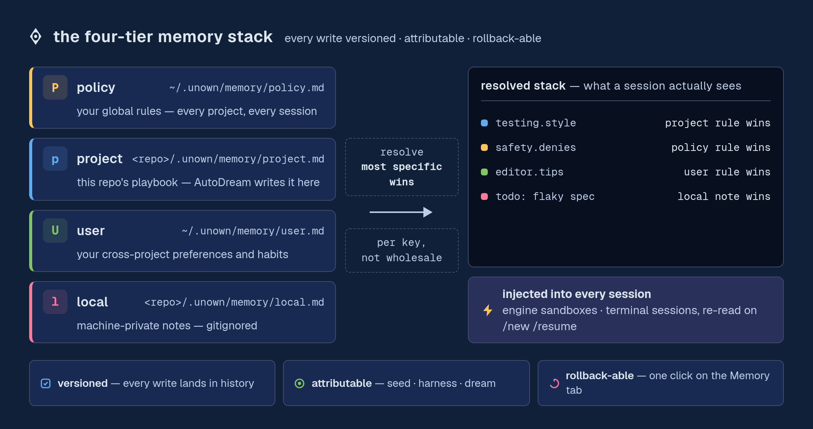
</p>

Everything is observable from a **mission-control dashboard** (Next.js) with live SSE activity, run transcripts, memory version history, dream journals, hook decision logs, an interactive console, and the job router.

## Architecture

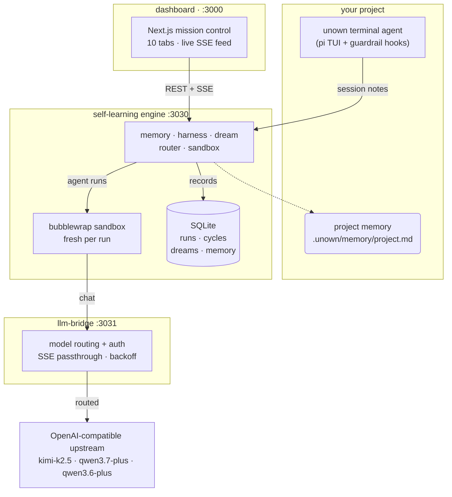

The dotted edge is AutoDream writing consolidated memory back into your project. Each harness/task run deploys a **fresh sandbox** (isolated directory, jailed exec, OS-level [bubblewrap](https://github.com/containers/bubblewrap) isolation, tamper-proof sha256-verified tests), injects the resolved tiered memory into the agent's system prompt, attaches the hooks extension, streams the transcript back, verifies the result, and records a session note for the next dream.

## The learning loop

The harness is the heart of the system — a verify-gated loop that only ever ships memory changes a fresh sandbox has proven correct, and that keeps itself supplied with things it cannot yet do:


---

## Documentation

Full usage docs live in [`docs/`](docs/):

| Page | What it covers |
|---|---|
| [quickstart](docs/quickstart.md) | clone → install → connect a model → first session (5 minutes) |
| [install](docs/install.md) | the one-line installer, requirements, offline/air-gapped installs, uninstalling |
| [updating](docs/updating.md) | `unown update`, update notifications, pinned installs, rollback, the privacy model of the update check |
| [providers](docs/providers.md) | `unown setup`, models.json / auth.json / settings.json, the bridge vs direct endpoints, custom providers |
| [usage](docs/usage.md) | every command, slash command, keybinding, session tool, plan mode |
| [subagents](docs/subagents.md) | the `task` tool, built-in `general`/`explore`/`background-explore`, authoring `.unown/agents/*.md` |
| [skills](docs/skills.md) | the Agent Skills format, the four starters, skills AutoDream mints on its own |
| [custom commands](docs/custom-commands.md) | authoring `.unown/commands/*.md` — frontmatter, `$ARGUMENTS`/`$1..$N` substitution, project + global scopes |
| [recipes](docs/recipes.md) | `unown recipes` + `/recipe` — declarative instruction bundles: typed parameters, `response_schema` structured output, file templates, sub-recipes |
| [repo wiki](docs/repo-wiki.md) | `unown wiki` + `/wiki` — auto-generated repo docs with `file:line` cross-links, DOT dependency graph, search |
| [ACP](docs/acp.md) | `unown acp` — the Agent Client Protocol server: drive the full agent from Zed and other ACP editors (JSON-RPC over stdio) |
| [permissions](docs/permissions.md) | the granular allow/deny/ask layer: config files, pattern semantics, trust gating |
| [usage tracking](docs/usage-tracking.md) | `unown usage`, the bridge's usage log, cost estimates and price pinning |
| [memory](docs/memory.md) | the 4-tier memory stack, session notes, AutoDream consolidation, the six integrity gates, [what a learning session looks like](docs/memory.md#what-a-learning-session-looks-like) |
| [memory-classifier-evaluation](docs/memory-classifier-evaluation.md) | objective evaluation of Jev/GLiNER-style classifiers in the memory system |
| [memory-system-review](docs/memory-system-review.md) | the memory subsystem's critical review: findings F1–F10, each status-tagged with receipts where live, and the matrix for re-running them |
| [local-model research](benchmarks/local-llm) · [non-LLM research](benchmarks/nonllm) · [complementary research](benchmarks/complementary) | hypothesis testbenches for the learning layer: small local LLMs (llama.cpp lane, H1–H11), the zero-LLM tier (ONNX encoders + MinHash/LexRank/activation lanes, H9–H15 + campaign #2's Ettin-17m reranker / BM25+RRF fusion H23–H24 — H15 shipped as the engine's opt-in dream lanes), and complementary local mechanisms (speculative decoding, semantic cache, H16–H22) — verdicts + receipts in each `results/REPORT.md` |
| [oh-my-pi-swap-assessment](docs/oh-my-pi-swap-assessment.md) | decision record: why the vendored pi harness stays, and what would reopen that call |
| [opencode-swap-assessment](docs/opencode-swap-assessment.md) | decision record: opencode clears both harness chokepoints, and is still not adoptable — why the blocker moved to the artifact |
| [sdlc-feature-parity](docs/sdlc-feature-parity.md) | decision record: which 2026-agent SDLC features (LSP, checkpoints/receipts, MCP, /review, /goal) were adopted, which stay out, and why — plus the hardening follow-ups |
| [configuration](docs/configuration.md) | every environment variable, `.env` semantics, state files layout, [production notes](docs/configuration.md#production-notes) |
| [windows guide](docs/windows.md) | native Windows: install, cmd/PowerShell shims, Git Bash + the powershell tool, sandbox story, WSL2 |
| [macos guide](docs/macos.md) | macOS: seatbelt sandbox notes, darwin prebuilds, install one-liners |
| [troubleshooting](docs/troubleshooting.md) | symptom → cause → fix (including `unown doctor` semantics) |
| [behavior](docs/BEHAVIOR.md) | the agent behavior card: default models, memory stack, session tools, sandbox, hooks, and the behavior-change policy |

---

## Quickstart

### Prerequisites

- [bun](https://bun.sh) ≥ 1.2 — macOS/Linux: `curl -fsSL https://bun.sh/install | bash` · Windows: `powershell -c "irm bun.sh/install.ps1 | iex"` (then open a new terminal)
- [git](https://git-scm.com) (any build; on Windows the standard Git-for-Windows install is fine)
- An OpenAI-compatible LLM endpoint (see *Using a different model provider* below)
- **Windows, macOS and Linux** — the full agent and stack run on all three; OS-level engine sandbox: **Linux (bubblewrap) + macOS (seatbelt)**; native Windows uses the in-process path jail (WSL2 gives you kernel-grade isolation). See the [Windows](docs/windows.md) and [macOS](docs/macos.md) guides

### 1. Install

Identical on every OS:

```bash
git clone https://github.com/kanishka-namdeo/Unown.git
cd Unown
bun run agent:install
```

Or the one-line installer (checks git, installs bun when missing, clones, installs — [docs/install.md](docs/install.md)):

```bash
curl -fsSL https://unown-nine.vercel.app/install.sh | sh
```

This installs dashboard dependencies, installs and builds the bundled pi monorepo (`pi-repo/` — hydrating its provider model data on first run, ~1–2 min), creates `.env` from `.env.example` if missing, and puts `unown` on your PATH (a shim into `~/.local/bin` on macOS/Linux, `%USERPROFILE%\.local\bin\unown.cmd` + `unown.ps1` on Windows — see below). Windows: if the installer just changed your PATH, restart your terminal; PowerShell may need `Set-ExecutionPolicy -Scope CurrentUser RemoteSigned` once for the `.ps1` shim.

**Keeping it current:** `unown update` moves the install to the newest release (fast-forward only, never over uncommitted work; `unown update --check` reports without changing anything) — [docs/updating.md](docs/updating.md).

### 2. Connect a model

**One credential is required: an upstream API key.** Either wire the bundled bridge (recommended — full stack, model routing, nothing secret on client machines):

```bash
# .env
BRIDGE_UPSTREAM_URL=https://dashscope.aliyuncs.com/compatible-mode/v1   # any OpenAI-compatible base URL
BRIDGE_UPSTREAM_KEY=<your key>
BRIDGE_KNOWN_MODELS=kimi-k2.5,qwen3.7-plus,qwen3.6-plus

unown setup --provider bridge     # point the terminal agent at it
```

…or skip the stack entirely and use any provider directly:

```bash
unown setup --provider openai --api-key sk-... --model gpt-4o
# presets: openai · openrouter · anthropic · dashscope · deepseek · custom (any OpenAI-compatible endpoint)
unown setup                        # or the interactive wizard
```

`unown setup` verifies the endpoint and key before declaring success, and writes `~/.unown/agent/{models.json,auth.json,settings.json}`. See [docs/providers.md](docs/providers.md).

### 3. Start

```bash
bun run agent:start
```

Boots three services:

| Service | Default port | Health check |
|---------|--------------|--------------|
| llm-bridge | 3031 | `GET /health` |
| self-learning engine | 3030 | `GET /api/overview` |
| dashboard | 3000 | `http://localhost:3000/dashboard` |

Logs land in `.run/*.log`; stop with `bun run agent:stop`. The launcher reads the bridge's `/health` (upstream key set? upstream answering?) and warns loudly instead of letting chats fail with a bare 401 later.

### 4. Use it in your terminal

`unown` runs the agent in your **real project directory** — the full pi TUI (file tools, bash, session management, `@file` mentions), plus the self-learning layer:

```bash
cd ~/code/my-project
unown                      # interactive session (like claude/pi, but learning)
unown "fix the failing tests"   # …optionally starting with a prompt
unown -p "explain the build error" | less   # one-shot headless (like claude -p)
unown --plan "add auth"    # plan mode: read-only exploration → numbered plan
unown setup                # connect a provider (wizard or flags)
unown models               # list configured models (+ what the bridge serves)
unown doctor               # end-to-end diagnostics: endpoint, keys, upstream, memory
unown memory               # print the effective 4-tier memory stack
unown note "watch out: flaky test in auth.spec"   # hand AutoDream a note directly
```

Every session is pre-flighted: if the model endpoint is unreachable or rejects the credentials, you get the exact fix (start the stack / re-run setup) instead of a stack trace. Full command and keybinding reference: [docs/usage.md](docs/usage.md).

Every session ships with **Claude Code-grade session tools** on top of pi:

- **`todo`** — a visible task list the agent maintains as it works (and `/todos` to inspect it). State rides the session tree, so branching keeps the right list.
- **`task`** — subagents with a **fresh context window** (`general` full-tool, `explore` read-only, `background-explore` — the same read-only shape on a cheaper model at low effort, no MCP, no memory injection — or your own `.unown/agents/*.md` definitions; run `/agents` to list). They are full unown agents: same memory, same guardrails — and their sessions write `[subagent]`-tagged notes, so **subagents learn too**. Up to 4 in parallel via `{tasks: [...]}`, with per-agent `model`/`effort`/`mcpServers`/`injectAgentsMd` routing, opt-in git `worktree_isolation` and `output_schema` typed replies (authoring guide: [docs/subagents.md](docs/subagents.md)).
- **`note`** — record a durable learning note **mid-session**; it reaches the engine immediately and AutoDream consolidates it into your project's memory (also `/note <text>`).
- **`fetch_url`** — read-only HTTP GET with HTML stripping and size caps.
- **`web_search` + `webfetch`** — **native web access** (the Claude Code / OpenCode surface, ported): ranked search results (title, URL, snippet) with provider auto-selection, then full page reads as text. Works **keyless out of the box** — DuckDuckGo → Tavily (keyless) → You.com → StackExchange → Wikipedia → HN, plus npm registry and GitHub repo search — and any of the 10 API-key providers (Tavily, Brave, Serper, Exa, Perplexity, Jina, Zhipu, DashScope, Kagi, SerpApi; Firecrawl on the fetch side) prepends itself to the chain the moment its key lands in `.env`. Both tools are SSRF-hardened (private-address DNS resolution refused), robots-aware and size-capped; `allowed_domains`/`blocked_domains` filter results. `UNOWN_WEB_SEARCH=0` / `UNOWN_WEBFETCH=0` disable either. Full provider table and key list: [docs/usage.md](docs/usage.md) · [docs/configuration.md](docs/configuration.md).
- **`lsp`** — language-server code intelligence (the oh-my-pi port): diagnostics, hover, go-to-definition, find-references and document symbols, with servers auto-detected on PATH (typescript-language-server, pyright, gopls, rust-analyzer, clangd, …) and configurable via `.unown/lsp.json`. After every write/edit the fresh diagnostics for that file ride the tool result — type errors get fed back to the agent instead of compounding (cold start never blocks; `UNOWN_LSP=0` disables). `/lsp` prints server status.
- **`/plan`** (or `--plan`, or Ctrl+Alt+P) — plan mode: write tools disabled, bash allowlisted to read-only commands; the agent explores, produces a numbered plan, and you approve execution with live `[DONE:n]` progress.
- **Checkpoints + receipts** (the codewhale port) — every session keeps an audit ledger at `.unown/receipts/` (every prompt, tool call and result — blocked calls land as error results; `/receipts` prints it with totals) and seals automatic turn checkpoints (`.unown/checkpoints/`): `/undo [n|--all]` reverts the last n turns' file changes, `/checkpoint [label]` + `/restore` rewind to named snapshots, and `/redo [n|--all]` re-applies undone changes (the opencode/Cursor undo→redo port — any new checkpoint clears the redo stack). Restore is jailed to your project dir; both trees are gitignored.
- **MCP client** (the Claude Code / codewhale / zcode port) — any Model Context Protocol server configured in `.unown/mcp.json` or `~/.unown/agent/mcp.json` (stdio or streamable HTTP) connects lazily in the background and its tools appear in the session as `mcp__<server>__<tool>`. Failed servers never block the session; `/mcp` reports status and reconnects, `unown mcp` manages entries from the shell, and `unown doctor` covers the session surfaces too; `UNOWN_MCP=0` disables.
- **`/review`** (the oh-my-pi + Codex port) — parallel reviewer subagents over a frozen diff (uncommitted work or a base branch): P0–P3 findings with confidence and file:line citations, deduplicated across reviewers, one SHIP/DO-NOT-SHIP verdict (strictest wins), saved to `.unown/reviews/`.
- **`/goal` + `--goal`** (the zcode Goal Mode + muse goals port) — durable objectives with evidence-verified completion: the `[GOAL:COMPLETE]` tag contract rides every turn, the completion gate requires the tag + every todo done + ≥2 evidence markers, and goal state survives `/new` `/resume` `/fork`.
- **`/commit` + `UNOWN_AUTO_COMMIT`** (the aider/Codex port) — git-native commits without handing over a shell: `git add -A .` jailed to the project dir + `git commit -m` — **never pushes**. `/commit <message>` uses your message verbatim; bare `/commit` generates a conventional one from the session's latest reply (`unown(session): …` + a `Generated-by: unown` trailer). Fresh clones with no git identity still commit (per-invocation `unown <unown@local>` fallback, never written to config); your pre-commit hooks run; not-a-repo / clean-tree are friendly no-ops; subagents and automation runs never commit. Opt in with `UNOWN_AUTO_COMMIT=1` (**default off**) to snapshot pending work when a session ends (`unown(auto): session end snapshot <date>`). Details: [docs/usage.md](docs/usage.md#git-native-commits-commit).
- **Automations** (the zcode port) — scheduled unattended agent runs managed by the engine: `unown automations create --title 'morning brief' --cron '0 9 * * 1-5' --prompt "..."` (5-field cron in your local timezone, or a one-shot `--delay-minutes`). Default mode is **read-only** — the run gets read/grep/find/ls/todo/note/fetch_url/web_search/webfetch/lsp (web tools are read-only network reads — an unattended "morning brief" needs the web), no shell or writes; `--mode standard` (full toolset) must be explicit, and its changes land in your working tree for git review. Definitions live in the engine's database, never in the repo; runs carry `UNOWN_AUTOMATION=1` so an automation cannot schedule more automations; every run is recorded (`history`) with output, exit code, turns and tokens. Needs the engine (`bun run agent:start`); missed slots older than 5 minutes are skipped, never replayed.
- **Skills** — four starter Agent Skills (`unown-self-learning`, `verification-first`, `methodical-debugging`, `repo-exploration`) are seeded into `~/.unown/agent/skills/`; drop per-project skills into `.unown/skills/<name>/SKILL.md` (pi implements the [Agent Skills](https://agentskills.io) standard, progressive disclosure included).
- **`/learning`** — re-print the effective 4-tier memory stack, fresh from disk.
- **`get_context_remaining` + `view_image`** — the context tools: how much context window is left (use it to decide whether to compact or hand off to a subagent before early turns fall off), and vision input for image-capable models (PNG/JPEG/GIF/WebP up to 4 MB, jailed to the project and tmp dirs).
- **`/blame`** — receipts-backed blame: `/blame <file>` shows which sessions and tool calls touched it (with `--session`/`--since`/`--json` filters); bare `/blame` summarizes the whole `.unown/receipts/` ledger (counts by tool, files written).
- **`/edit-resend`** — edit an earlier turn: `/edit-resend <n> "<new message>"` reverts files to the pre-Nth-user-message checkpoint (all-or-nothing) and resends your edited message as the new leaf; `/edit-resend list` prints the indices.
- **`/sessions` + `unown sessions`** — export a session to one self-describing JSON (manifest, messages, todos, notes, skills, files), rehydrate it on another machine, list what exists in the project (`/sessions export|import|list` in-session, `unown sessions export|import|list` from the shell).
- **Recipes** (the goose port) — `unown recipes list|run|create|validate` and `/recipe <name> --key value`: markdown bundles in `.unown/recipes/*.md` (project) or `~/.unown/recipes/*.md` (user) pairing a task prompt with typed `parameters`, a `response_schema` the reply must satisfy (validated with corrective retries), file `templates`, `sub_recipes`, and `model`/`effort`/`allowed_tools` routing — [docs/recipes.md](docs/recipes.md).
- **Repo wiki** (the zcode port) — `unown wiki generate|search|list|show` and `/wiki`: parallel read-only subagents document every module with `file:line` citations into `.unown/wiki/` — index, module pages, a DOT dependency graph with cycle detection, a changes page and a `wiki.json` manifest; regeneration is deliberate (`--force`) — [docs/repo-wiki.md](docs/repo-wiki.md).
- **`/permissions`** — the granular permissions layer's status surface: mode, rule table with the file each rule came from, trust state, and `/permissions trust` to approve a project `.unown/permissions.json` ([docs/permissions.md](docs/permissions.md)).
- **`/init-agents` + `/doctor-instructions`** — generate an `AGENTS.md` from repo forensics (in-session preview; `unown init-agents` writes it — `--print` to stdout, `--overwrite` to skip the prompt) and audit the whole instruction set — AGENTS.md freshness, skills, MCP orphans, hooks schema, adversary mode, injection scanner (`unown doctor-instructions --json` for the machine-readable report).
- **Routing flags** — `--model <id>`, `--effort low|medium|high`, `--mcp-servers <csv>`, `--no-agents-md` on any launch (TUI or print mode): per-session model, reasoning-effort, MCP-whitelist and memory-injection routing — the same knobs agent definitions use per-subagent; `UNOWN_SUBAGENT_MODEL` re-points every subagent at once ([docs/subagents.md](docs/subagents.md#per-agent-routing)).
- **User-configurable hooks** — `.unown/hooks.json` (project, refuse-first trust-gated via `/hooks trust`) and `~/.unown/agent/hooks.json`: **13 events** (`SessionStart` … `PermissionRequest`) with five handler types (`command`, `http`, `mcp`, `prompt`, `agent`) that run in terminal sessions too — plus adversary mode (`~/.config/unown/adversary.md`), an LLM reviewer that re-checks destructive bash/write/edit calls when the gate file exists.
- **ACP** — `unown acp` runs the Agent Client Protocol server (JSON-RPC over stdio): drive the full agent — sessions, tools, guardrails, learning — from Zed and other ACP editors — [docs/acp.md](docs/acp.md).
- **Usage tracking** — `unown usage`: token/cost report from the bridge's request log (`--days`, `--model`, `--json`) — [docs/usage-tracking.md](docs/usage-tracking.md).

What the terminal session does for you:

- **Memory** — the resolved stack (global policy → your project's `.unown/memory/project.md` → global user memory → `.unown/memory/local.md`) is injected into every session (re-read on each `/new` `/resume` `/fork`, so AutoDream's updates land without a restart), alongside your own `AGENTS.md`/`CLAUDE.md` chain if present.
- **Skills that grow themselves** — when your session notes keep describing the same multi-step procedure (how to run this test suite, how to deploy, how to debug the flaky part), AutoDream mints it as an Agent Skill into `.unown/skills/<name>/SKILL.md` — versioned in the engine, rollback-able and retire-able from the dashboard — and the very next session can use it (progressive disclosure: only the name + description ride the prompt until needed).
- **Guardrails** — catastrophic commands (`rm -rf /`, fork bombs, disk formats) and out-of-project writes are blocked before execution; broken JS/TS you (or the agent) write gets the transpiler error fed back instead of compounding. Normal work — network, `git push`, package installs — is allowed. Set `UNOWN_STRICT_HOOKS=1` for sandbox-grade strictness.
- **Learning** — when you exit, a session note is delivered to the engine; AutoDream consolidates your notes into an updated `.unown/memory/project.md`, so the next session starts where the last one ended. Notes queue in `~/.unown/notes/outbox/` when the engine is down and sync automatically later.

Install the command globally (optional):

```bash
bun run agent:link         # writes a `unown` shim into ~/.local/bin → this checkout
                         # (Windows: %USERPROFILE%\.local\bin\unown.cmd + unown.ps1,
                         #  and appends the dir to your user PATH)
```

A shim (not `bun install -g .`) is the supported global-install path: it keeps the vendored pi workspace resolution and subagent spawning intact. Re-run it after moving the repo. Full reference: [docs/usage.md](docs/usage.md).

### 5. Watch it learn

Open **http://localhost:3000/dashboard**:

- **Overview** — pass rate, shipped improvements, dream count, memory version, hook decisions, token usage.
- **Learning Lab** — every harness cycle: baseline run → failure diagnosis → proposed memory patch → candidate run → ship/reject, with full transcripts.
- **Memory** — the four tiers, their contents, full version history and one-click rollback — plus the Agent Skills AutoDream minted into your projects (with rollback and retire).
- **Dreams** — AutoDream sessions: merged / pruned / added notes and the consolidated memory they produced.
- **Hooks** — the decision log of every guardrail (allow / deny / augment).
- **Console** — drive the sandboxed agent interactively and watch the transcript stream.
- **Router** — background jobs: enable/disable, trigger manually, see run counts and next-fire times.
- **Sandboxes** — the workspace inventory the engine has materialized for sandboxed runs, with ages and file counts.
- **Gateway** — the llm-bridge request log: per-model traffic, tokens, latency, errors.
- **Automations** — scheduled headless `unown` runs (cron or one-shot): create, run now, pause/resume, per-run history.

The tab strip is URL-addressable (`?tab=<name>`) and every tab is reachable from the ⌘K command palette.

The engine seeds itself on first boot: default memory tiers, five benchmark tasks (`fizzbuzz`, `impl-debounce`, `map-limit`, `drop-right`, `fix-csv-parser`), and the router jobs. Leave it running and the `harness-cycle` job will keep mining failures and shipping memory improvements on its own.

---

## Landing page

`bun run agent:start` (or `bun run dev`) serves a **marketing landing page at `/`** and **mission control at `/dashboard`**.

The landing page is built around the name. Unown is the Symbol Pokémon — a flat black letter with one eye, alive since 1999, found on the walls of ruins reading what is written there — and `unown` is a pun you have to read twice. So the page carries a **28-form alphabet drawn from scratch for this project** (inline SVG, no font file, no sprite sheet): hover or focus any form in the wall to decode the lore it borrows and the real mechanism it stands for here.

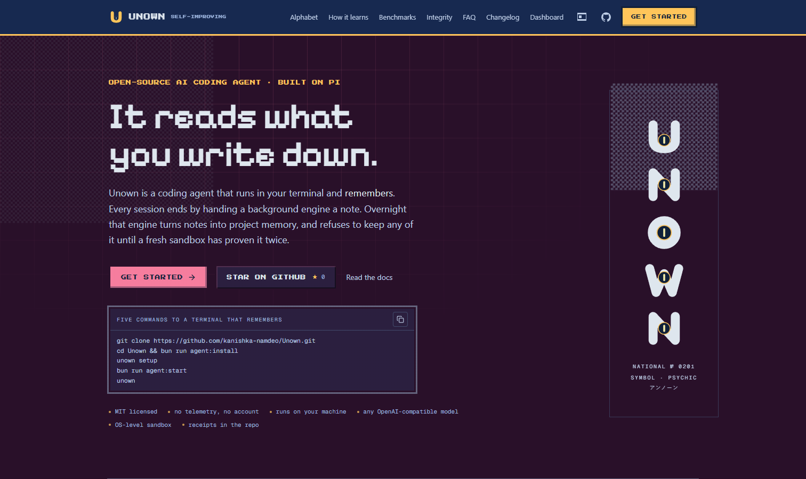

Every number and every quoted artifact on that page is checkable, nothing from a Pokémon release is bundled or reproduced, and the page says plainly that it is an independent project. The design rationale, the lore sourcing rules and the asset licences are in [`docs/landing-research.md`](docs/landing-research.md); the section contracts are in [`src/components/landing/AGENTS.md`](src/components/landing/AGENTS.md).

---

## Mission control

The dashboard is a live window onto the engine — every number below is real data from a running instance, streamed over SSE:

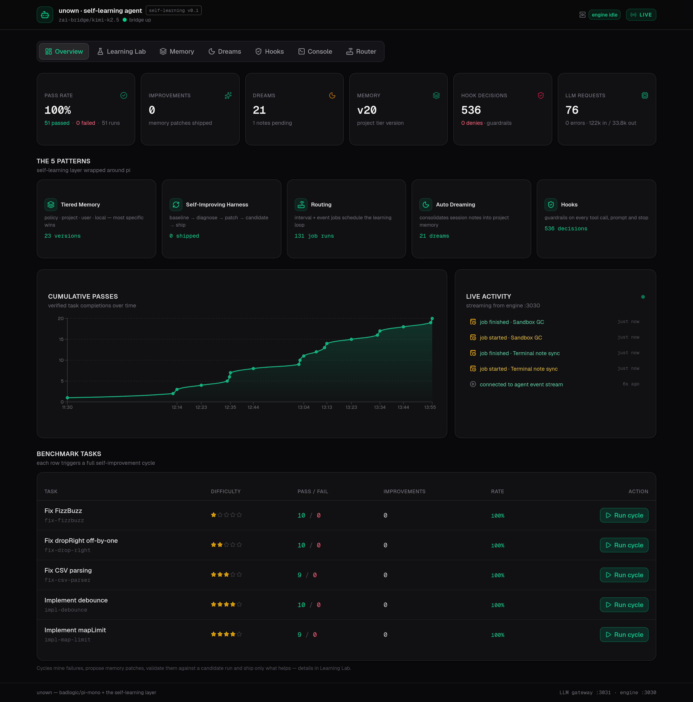

| | |
|---|---|
| 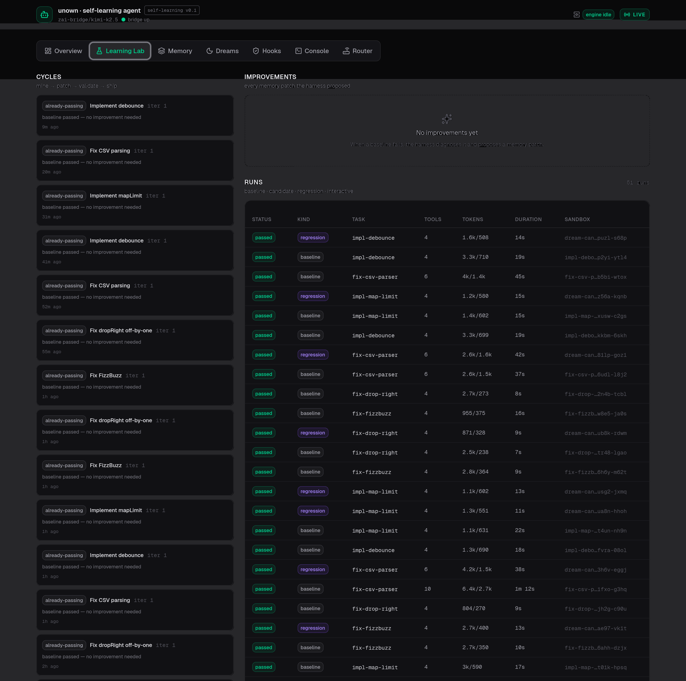 | 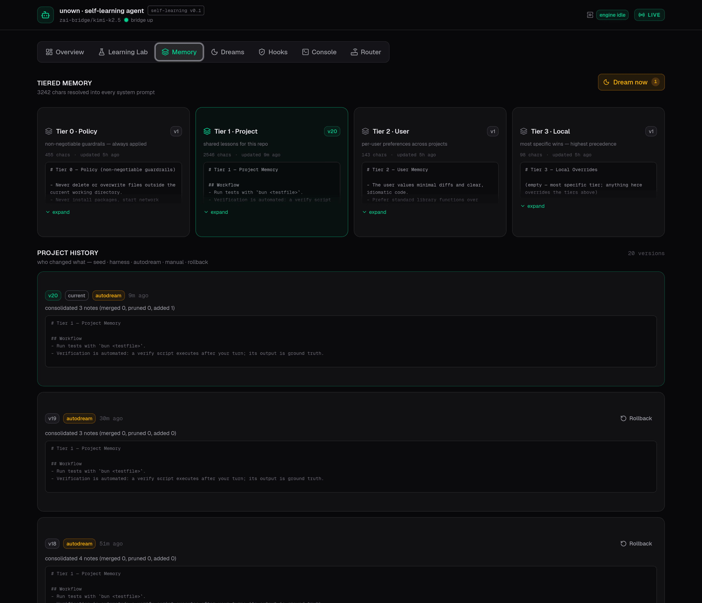 |
| 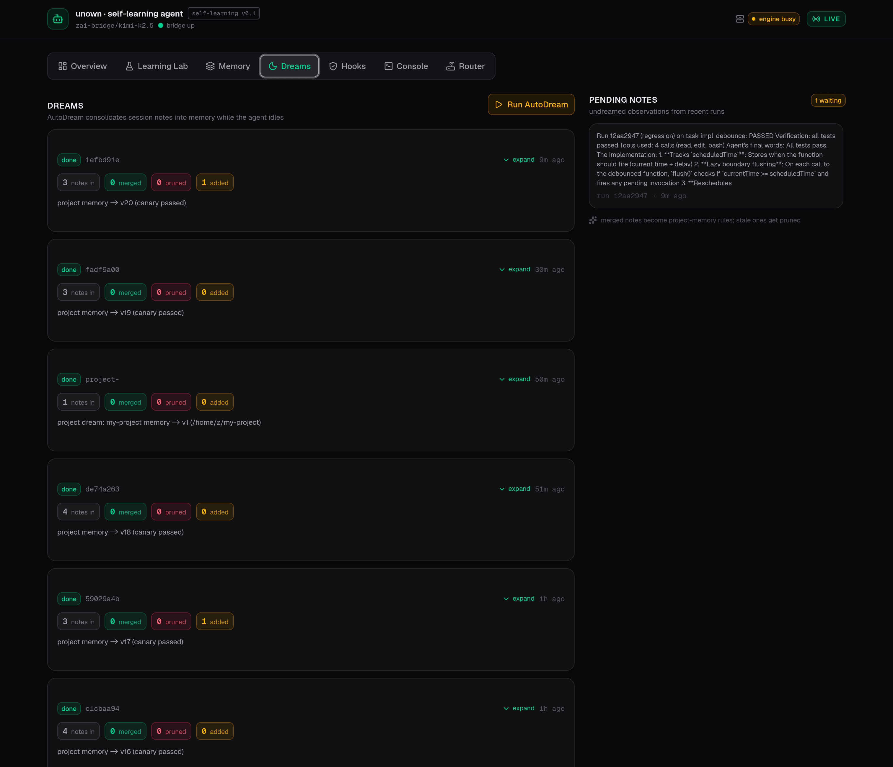 | 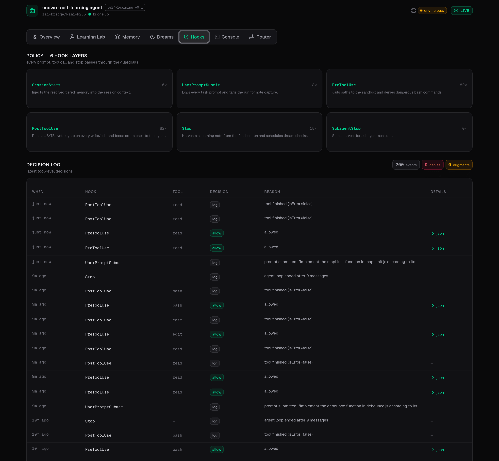 |
| 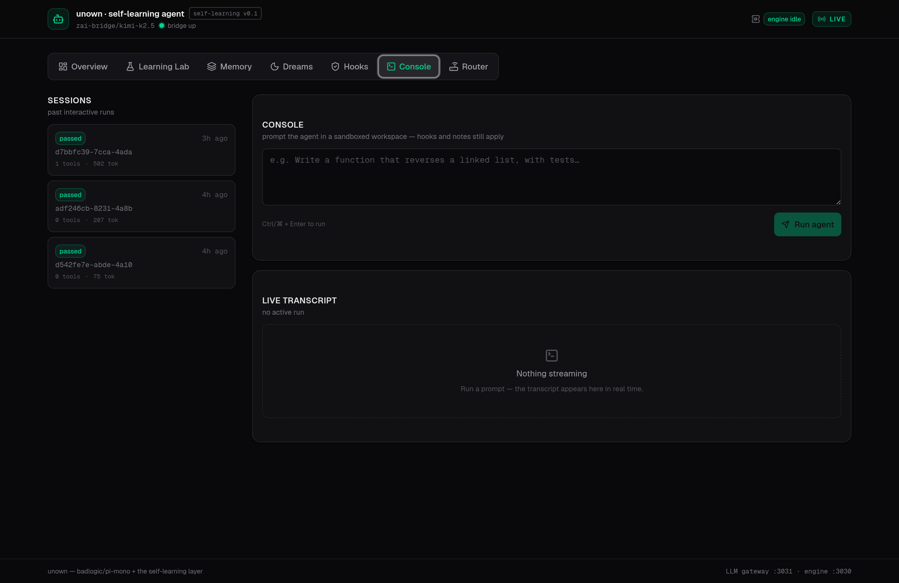 | 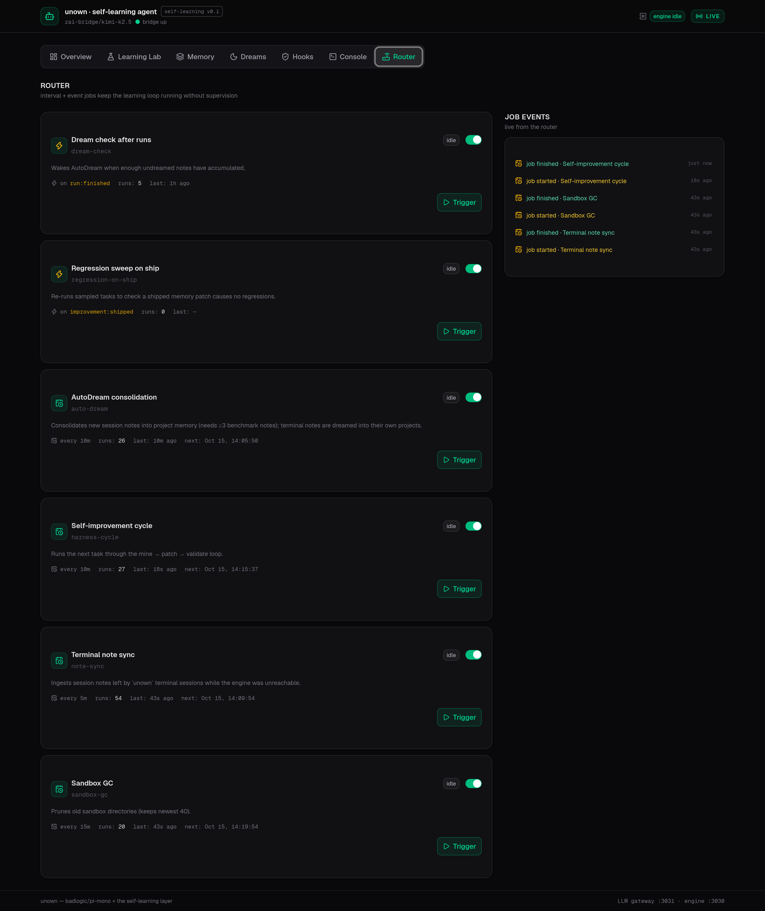 |

It is fully responsive — the same live KPIs, chart and activity feed on a phone:

<p align="center">
  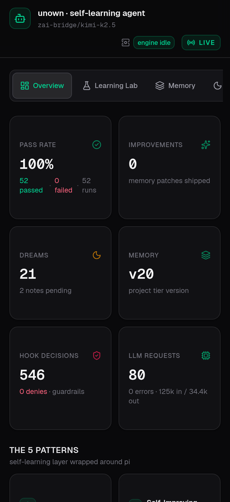
</p>

## Configuration

All variables are optional with sane defaults; author `.env` from [`.env.example`](.env.example). The **full reference** — engine, bridge, dashboard, terminal and sandbox variables, `.env` loading semantics, state files and agent config files — lives in [docs/configuration.md](docs/configuration.md), alongside the [production notes](docs/configuration.md#production-notes) (run the engine without hot reload, put `BRIDGE_API_KEY` on the bridge, scale by running more single-tenant instances).

### Using a different model provider

The bundled `llm-bridge` turns **any OpenAI-compatible upstream** (Dashscope, OpenAI, OpenRouter, vLLM, llama.cpp server, …) into a local endpoint the pi agent can use: it injects upstream authentication, routes requested model ids onto its allow-list, translates `thinking` flags for qwen models, passes tool calls and image content through natively, streams SSE back untouched, and serializes/throttles/retries requests. Or skip the bridge entirely — `unown setup` connects the terminal agent straight to any provider (see [docs/providers.md](docs/providers.md)).

```bash
PI_BRIDGE_URL=https://api.openai.com/v1 \
PI_MODEL_ID=gpt-4o \
PI_PROVIDER=openai \
bun run agent:engine
```

## Security model

- **Sandboxes (OS-level)**: every engine run — verify scripts *and* the agent's own bash commands — executes under the OS sandbox: **bubblewrap** on Linux (read-only root filesystem, private `/home` `/tmp` `/run`, killed network namespace, dropped capabilities) and **seatbelt (`sandbox-exec`)** on macOS with a bwrap-equivalent profile. **Native Windows has no OS sandbox** — engine runs there use the in-process path jail, the same degradation Claude Code ships on native Windows (WSL2 gives you kernel-grade isolation). A verified bwrap binary is vendored in `pi-repo/packages/self-learning/native/` with recorded sha256 provenance (Linux only). Set `UNOWN_OS_SANDBOX=0` to disable, `UNOWN_SANDBOX_NET=1` to keep the network shared.
- **Sandboxes (process)**: executed commands are jailed to the workspace with timeouts and output caps; benchmark tests are sha256-pinned so the agent cannot tamper with verification.
- **Hooks (engine)**: `PreToolUse` denies destructive shell (`rm -rf /`, `sudo`, outbound `curl`/`wget` to external hosts…), the path jail blocks escapes, and the `PostToolUse` syntax gate feeds transpiler errors back to the agent instead of letting broken code compound.
- **Hooks (terminal)**: the same gate protects interactive sessions but scoped for real work — catastrophic commands and writes outside your project/`/tmp` are blocked; network, `git push` and installs stay available. `UNOWN_STRICT_HOOKS=1` restores the sandbox-grade policy.
- **LLM bridge**: optional bearer auth, request serialization and rate-limit backoff.
- **No secrets in the repo**: the engine reads credentials from its environment at runtime.

The six **learning-integrity gates** that police self-modification (ship gate, mint gate, dream canary, retention check, skill mint gate, full version history) are documented in [docs/memory.md](docs/memory.md#learning-integrity-how-the-system-polices-itself).

## Credits

- [badlogic/pi-mono](https://github.com/badlogic/pi-mono) — Mario Zechner's pi coding agent, bundled and extended here.
- The five self-improvement patterns popularized by Anthropic's engineering blog on improving Claude Code with Claude Code.
- Unown v1 — the Claude Code harness blueprint this project grew out of — is preserved under [`blueprint/`](blueprint/) as reference material.

## License

MIT — see [LICENSE](LICENSE).
