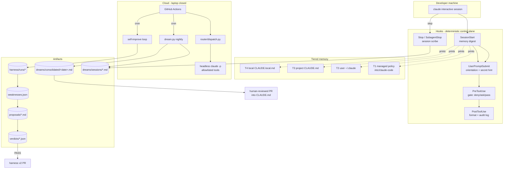
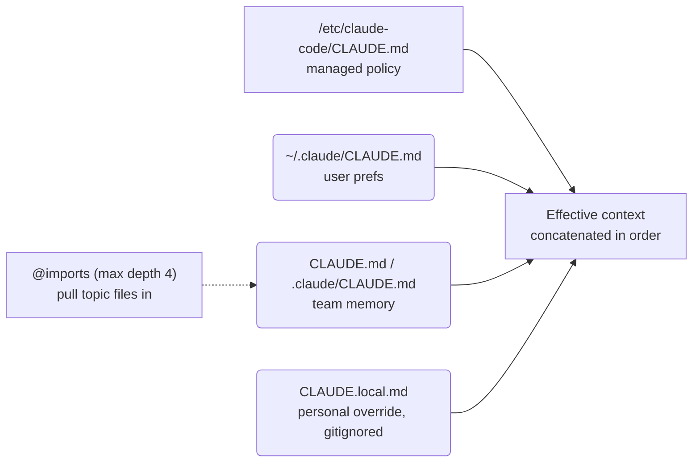
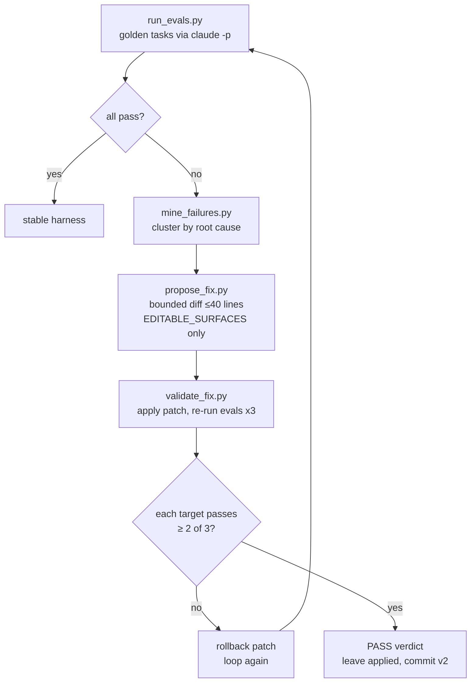
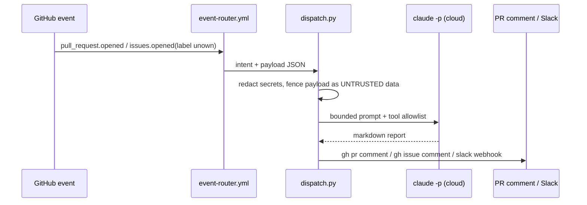
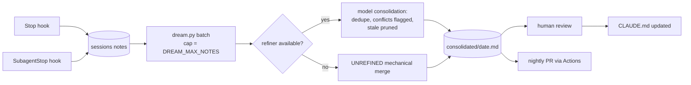

# Unown Architecture

Five mechanisms, one control plane. Diagrams are GitHub-renderable mermaid.

## 1. System overview

## 2. Tiered memory resolution

Tiers **concatenate** into context at launch; specificity of instruction breaks
conflicts — not file shadowing. The digest makes the stack visible every session.

## 3. Self-improving harness loop

Keep the model stable; make the harness editable; gate promotions on evals.

Hard guarantees:
- Proposals may only touch files whitelisted in `harness/EDITABLE_SURFACES`.
- Diff size is bounded and machine-enforced.
- Nothing promotes without `PASS` from the gate (`verdicts/*.json`).
- Offline mode makes all of this testable with zero API spend.

## 4. Routing data flow

The PreToolUse hook is active even in headless mode — a routed session that
tried a force-push would be denied deterministically.

## 5. Auto-dreaming pipeline

state.json marks consumed notes → runs are incremental, idempotent, cheap.

## 6. Failure/boundary behaviour

| Boundary | Behaviour |
|----------|-----------|
| Hook script raises | exits 0 with stderr warning — agent never bricks |
| Proposal targets non-whitelisted file | gate verdict `REJECT` |
| No claude CLI anywhere | offline/unrefined paths keep pipelines alive |
| Missing SLACK_WEBHOOK_URL | post skipped, result printed to logs |
| Stranger opens issue without label | router declines (cost guard) |
